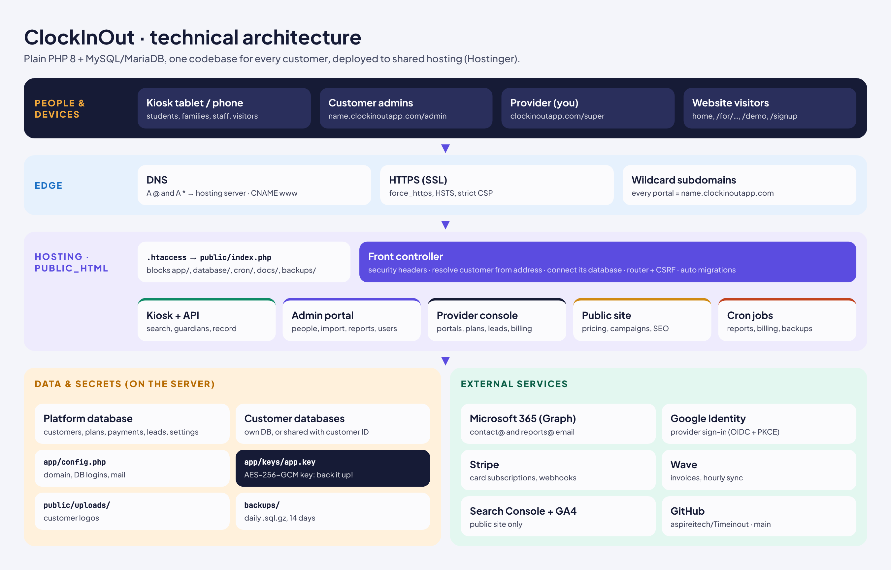
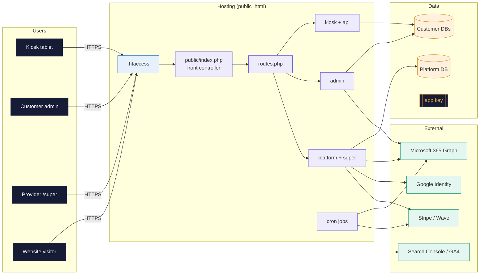
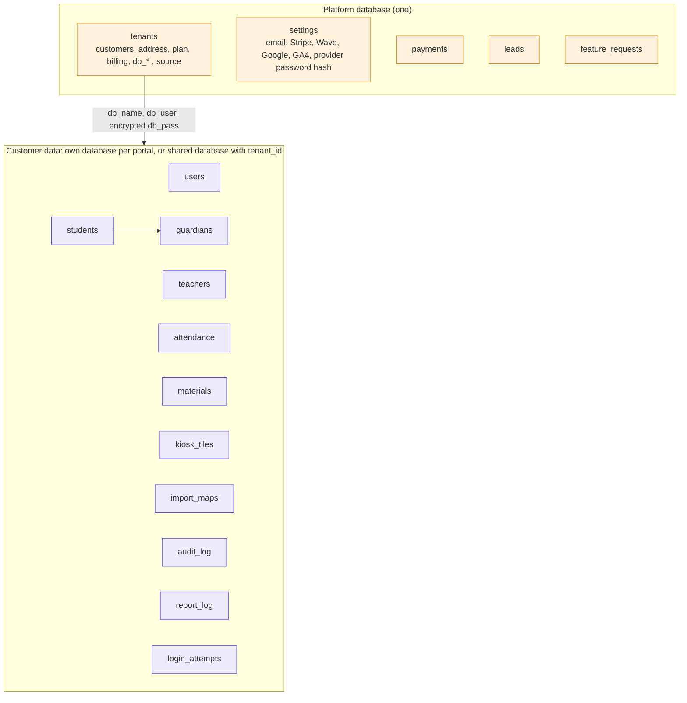
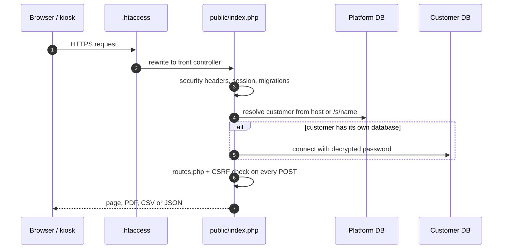
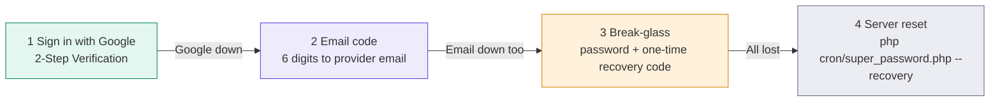
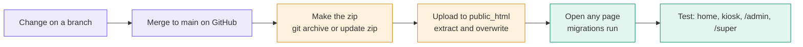
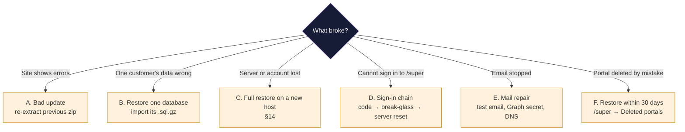

# ClockInOut — Master Guide

The single reference for ClockInOut: what it does, how it is built, how to configure, run, back up,
recover and move it. Hand this document to anyone who needs to take over the product.

| | |
|---|---|
| Product | ClockInOut, time & attendance for any front door — <https://clockinoutapp.com> |
| Code | GitHub **`aspireitech/Timeinout`** (public), branch **`main`** |
| Stack | PHP 8.1+ · MySQL 8 / MariaDB 10.4+ · Apache (`.htaccess`) · no framework, no build step |
| Hosting today | Hostinger shared hosting, code in `public_html` |
| Schema version | **25** (applied automatically on the first request after an update) |
| Last updated | 2026-11-12 — see [§18 Change log](#18-change-log) |

> **Never put real passwords, keys or customer data in this file or anywhere in the repository.**
> The repository is public. Secrets live only on the server (`app/config.php`, `app/keys/app.key`,
> the database) and in your password manager.

**Contents**
1. [Product overview](#1-product-overview) · 2. [Repository and branches](#2-repository-and-branches) ·
3. [Architecture](#3-architecture) · 4. [Data model and multi-tenancy](#4-data-model-and-multi-tenancy) ·
5. [Request flow](#5-request-flow) · 6. [Roles and sign-in](#6-roles-and-sign-in) ·
7. [Configuration reference](#7-configuration-reference) · 8. [Integrations](#8-integrations) ·
9. [Scheduled jobs](#9-scheduled-jobs-cron) · 10. [Security controls](#10-security-controls) ·
11. [Deploying and updating](#11-deploying-and-updating) · 12. [Backups](#12-backups) ·
13. [Disaster recovery](#13-disaster-recovery-runbooks) · 14. [Moving to another host](#14-moving-to-another-hosting-provider) ·
15. [Day-to-day operations](#15-day-to-day-operations) · 16. [Troubleshooting](#16-troubleshooting) ·
17. [Keeping this guide current](#17-keeping-this-guide-current) · 18. [Change log](#18-change-log)

---

## 1. Product overview

ClockInOut puts a tablet at the door. People sign in and out in a few taps; admins see live
attendance and get reports by email. Every customer (school, daycare, tutoring center, office,
clinic, gym…) gets its own portal at `name.clockinoutapp.com`.

| Area | What it does |
|---|---|
| **Kiosk** (`/` on a portal) | Tiles chosen per industry (students, staff, visitors, material pickup). Type a few letters → tap the name → choose who is with them (guardian on file, **Authorized relative** who types a name and picks a relationship, or **Self** for adults with no guardian) → Sign in / Sign out. One sign-in at a time; past days only as far back as the admin allows. |
| **Admin portal** (`/admin`) | Dashboard, today's attendance, activity log, reports (on screen, PDF, CSV, email), students & guardians, staff, pickup materials, import (Excel/CSV with column matching and undo), kiosk tiles, branding & settings, billing, users, audit log, Help & FAQ, What's new, feature requests. |
| **Provider console** (`/super`) | All portals (create, plan, status, delete/restore, owner password reset), leads, feature requests, payments, audit log, email/payment/Google settings, provider sign-in security. |
| **Public website** | Home, pricing (monthly/yearly), six campaign pages `/for/<industry>`, `/demo`, `/signup`, `/whats-new`, share links, SEO (sitemap, robots, structured data). |
| **Trial and billing** | Self sign-up → portal live at once, welcome email with the address and first steps. Bold trial banner (orange in the last 2 days). When the trial ends the admin portal opens only Billing (and Help) until a plan is chosen; the kiosk keeps working 7 more days, then pauses. Billing shows Yearly (2 months free) first with Business highlighted; without online payment set up, "Choose plan" emails you to send an invoice. |
| **Trial follow-up** | `app/lib/nurture.php`, run hourly. Emails the trial owner once per step, at most one a day, only 9:00–17:00 in the customer's time zone (portal setting, kiosk device, else their state): *import* (day 1+, no own people yet), *kiosk* (day 2+, no check-ins), *two-days* and *last-day* (with the optional promotion line). Alerts you (8:00–18:00 your time) when a trial has no check-ins after 2 days or ends tomorrow, with owner, people, check-ins and source. Every Monday from 8:00 in your time zone (`outreach_tz`) emails you a scorecard: new sign-ups, payments, paying customers, MRR, sign-ups and leads by source, open trials. Never emails paying customers or the demo. Sent emails are logged in `nurture_log`. On/off and promotion line in `/super → Settings`. |
| **Provider alerts** | To the contact mailbox, with a copy to `alert_emails` (`provider_alert()`, `alert_copies()` in `app/lib/mailer.php`): new sign-up, card subscription, payment received, payment failed (subject starts with ACTION), cancellation, demo request, invoice request, feature request, subdomain to-do, trial alerts, Monday scorecard, suspicious-activity report, recovery-code and break-glass sign-ins. |
| **Sales dashboard** | `/super/sales` (`app/lib/sales.php`, `app/controllers/sales.php`, `app/views/platform/super_sales.php`). Any date range (last 7/30/90 days, this or last month, this year, custom) by day, week or month, in `outreach_tz`. Headline cards with change against the previous period of equal length: prospects found, emails sent, delivered %, clicked %, replied %, demos, sign-ups (opens only when turned on); rate rings and a funnel (emailed → delivered → clicked → replied → demo → signed up); one small chart per measure over time (found, sent, people who clicked, replies, demos and sign-ups; hover for values); where every prospect stands today; which business types and states answer (emailed, bounced, clicked, replied, interested, signed up); all sources (website demo requests, trials, paying customers from outreach). Data: `prospect_events`, written by `prospect_event()` from the finder (`found`), the hourly send (`sent`), the inbox check (`bounced`, `replied`), tracked links (`clicked`), unsubscribe, the demo and sign-up forms (`prospect_converted()`) and status changes in /super → Prospects. **Clicks:** links in outreach emails go through `GET /r?t=<token>&s=<step>&to=signup|demo|home` (fixed targets, no open redirect), which counts people, not clicks, and ignores link scanners (bot user agents, HEAD, within 90 s of sending) and your own preview clicks. **Opens:** optional 1×1 image `GET /o?t=…` only when `outreach_track_opens` is on (default off: iPhones open every email by themselves and tracking images hurt cold-email delivery). **Every number is clickable:** cards, rings, funnel rows, chart bars (that day, week or month), the business-type, state and traffic-source tables open `/super/sales/list?m=<metric>&range…` (optional `kind`, `state`, `source`) with the records behind it (prospects with contact details and status now, visits with pages viewed, demo requests, sign-ups, paying customers) and a CSV download (`super_sales_list()`, `SALES_LISTS`). Server-side SVG charts, no chart library. **Call today (hot list):** prospects who clicked an outreach link in the last 7 days and have not replied, booked a demo or signed up, sign-up/demo page lookers first, with phone and contact name (`sales_hot_leads()`); also emailed every weekday from 8:00 `outreach_tz` with yesterday's visits, demo requests, sign-ups, emails and replies (`run_hot_leads()`, hourly job task `hotlist`, `hotlist_on`, `hotlist_last`). **Website traffic** (`app/lib/traffic.php`, `traffic_record()` called by `public/index.php` for the main pages `/`, `/signup`, `/demo`, `/whats-new`, `/status`, `/for/<page>` and the share links): one row per page view in `site_visits`; visitor = daily-changing hash of IP + browser with a random `traffic_salt` (no counting cookie); bots, link previews and your own /super session left out; source = `?src` / `?utm_source` / share link, else the referring site (google, bing, facebook, linkedin, chatgpt, perplexity…), else direct; rows kept 400 days (`traffic_purge()`). The dashboard shows visits, phone share, demo requests and sign-ups, visit → lead rate, visits over time, landing pages, and every source with its demo requests, sign-ups and conversion. **Attribution:** the first outside source is kept in the first-party cookie `cio_src` (90 days, HttpOnly) and `lead_source()` falls back to it, so a lead or sign-up days later is credited correctly; an outreach click also sets `cio_p` (the prospect token) and `prospect_converted_cookie()` marks that prospect as demo / signed up even with another email address. Outreach website links open the landing page for the prospect's kind of business (`sales_campaign_for()`). Website traffic also appears in the Monday scorecard. |
| **Missed sign-out reminders** | Free optional feature (`app/lib/reminders.php`; Admin → Features & add-ons → **Missed sign-out reminders**). At the portal's report hour (default 7:00, portal time zone), for yesterday's sign-ins without a sign-out (with **No reminders on Saturday and Sunday**, on by default: nothing at weekends; Friday–Sunday misses are emailed on Monday morning): staff get "⏰ Hannah, you didn't sign out on Monday" (teacher email), and the guardian who did the drop-off gets "Ava wasn't signed out at pickup on Monday" with a **Stop them** link (`/reminders/stop?g=&k=`, HMAC token with `app.key`, `reminder_optout`). Admin chooses **Staff and parents / Staff only / Parents only** (`signout_mode`). Sent from reports@ with Reply-To the portal's first report recipient (else the owner). One per person per day (`reminder_log`); visitors, authorized relatives and people without an email are not emailed. No extra admin email: the daily report's "Signed in but never signed out" list notes per person "reminder emailed", "no email on file", "family stopped reminders" and "N times in 30 days" (3+). Never sets a sign-out time automatically. Optional **closing-time check** (`closing_time`): within the hour after it, if anyone is still signed in today, one email "⚠️ N still signed in after closing at …" to the report recipients with who brought each child and their phone; nothing when everyone has left; once a day. Hourly job tasks `reminders` and `closing` run before `reports`. |
| **Outreach A/B test, founding offer, call-back page, nightly review** | Each new prospect gets version **A** (designed email: banner, button, checkmarks) or **B** (`prospect_email_plain()`: short plain personal note, no images, subject "Quick question about {org}", one link to the call-back page) at random; the share for B is `ab_plain_pct` (default 50); the version is kept for the follow-ups, which thread under email 1 (`In-Reply-To`/`References`). **Founding offer** (`outreach_offer()`, setting `outreach_offer`, default on): "we set everything up for you for free, and 50% off your first 3 months" for the first 20 businesses, in both versions and on the call-back page; Stripe Checkout allows promotion codes (`allow_promotion_codes`), so a coupon/promotion code such as **FOUNDING50** created in Stripe works at checkout (the provider honours the first 20). **Call-back page** `/hello?t=<token>` (link target `hello` through `/r`): name, phone, best time, organization, optional email, prefilled from the prospect; saves a lead (source `outreach`), sets the prospect to Booked demo, emails you; also links to the free trial. **Business types can be paused** (`outreach_pause_kinds`): no new first emails for them, follow-ups continue. **Nightly review**: a Claude scheduled task reads `GET /api/prospects?summary=1` (now with `ab`, `by_kind`, `tuning`, `callbacks_7d`) and posts `{"tune": {daily_cap, plain_pct, pause_kinds, offer, note}}` to `/api/prospects` (same key); `outreach_tune()` clamps the daily cap to 10–50 and at most +10 per night, then emails you the review ("Nightly sales review"). The Sales dashboard shows an **Email A/B test** card and the last review. |
| **Free checklist and email list** | `app/lib/subscribers.php`, `app/controllers/subscribers.php`, `app/views/partials/checklist_popup.php`, `app/views/platform/checklist.php`. A small slide-in on the home page and every `/for/<page>` (after 40 seconds or 60% scroll; at most once every 30 days per browser via `localStorage`; never again after signing up, cookie `cio_sub`; thin card above the start-trial bar on phones; on/off `popup_on` in /super → Settings) offers a free printable checklist: **care** (safe drop-off and pickup, for schools, daycares, tutoring) or **work** (staff hours and front desk, for every other business), preselected by landing page (`CHECKLISTS`). `POST /subscribe` (CSRF, hidden bot field, 5 new addresses per hour per network, same answer for new and existing addresses) saves the address in `subscribers` with its source (`lead_source()`) and emails the checklist at once; `GET /checklist/care` and `/checklist/work` are public printable pages (counted in website traffic) with the free trial, demo and an "Email me a copy" form. Hourly task `subscribers` (`run_subscribers()`) sends one follow-up 3 days later (free trial + founding offer with code FOUNDING50), unless the address has signed up since (`subscriber_converted()` at sign-up). Every email has an unsubscribe link `GET|POST /subscribe/stop?t=<token>` and the postal address (`outreach_address`). Sales dashboard → Website traffic → **Checklist sign-ups** opens the list with CSV. |
| **Focused website, founder block, demo videos** | Home page (`app/views/platform/home.php`) is built around one job: "Sign in and out at the door. Know who's here." with the founding offer and places left, two 40-second demo videos (`public/assets/video/*.mp4`, posters `*.jpg`), three jobs (safe pickups, staff hours, who is here now), "Built for" links to the landing pages, 3 steps, a founder block (`app/views/partials/founder.php`: name and phone from /super → Prospects, photo `public/assets/img/founder.jpg` if present, else initials) and the Free plan strip under pricing. Landing pages `/for/<page>` show the offer, the matching video and the founder block. **Powered by ClockInOut**: a plain line in the kiosk footer (no link, so the kiosk cannot be left) and a tagged link (`?src=powered-report` / `powered-reminder`) in report and reminder emails (`powered_by_html()`). |
| **Google Ads conversion tracking** | /super → Settings → Google Ads: conversion ID `gads_id` (`AW-…`) and labels `gads_label_signup` (new free trial: the welcome page after sign-up) and `gads_label_lead` (demo request, call-back request, checklist sign-up thank-you). Views set `$GLOBALS['gads_conv']`; `app/views/partials/share.php` loads gtag on the public website only and sends the conversion (and GA4 `sign_up` / `generate_lead` when GA4 is set). The checklist thank-you counts only after a real form post (session flag), not when the URL is opened. Google Ads domains are added to the Content-Security-Policy only on the public site when an ID is set. Campaign plan: Confluence page 16. |
| **Outreach to prospects** | `/super → Prospects` (`app/lib/prospects.php`, `app/controllers/prospects.php`). Prospects are pasted in, or posted by the daily Claude prospect finder to `POST /api/prospects` (header `X-Api-Key`; only its hash is stored; `GET` returns domains already known; `GET ?summary=1` returns counts by status, today's sends, the last 50 sends, today's delivery numbers (accepted, in Sent, bounced, replied), the last 30 delivery-log rows, the mailbox check status and the hourly job status, read-only). Each gets email 1 written for its kind of business (`prospect_pitch()`: childcare/tutoring/schools, clinics and dental, offices, retail and restaurants, gyms, construction and field crews; matching banner and sign-up link with `industry=`), a follow-up after 4 days and a last note 5 days later, in the prospect's local time from their state (`STATE_TZ`, `prospect_send_window()`): Tue–Thu 9–12 and 13–15, Mon 10–12 and 13–15, Fri 9–12; at most `prospects_daily` (default 25) a day and `prospects_daily`/4 (7) per hourly run, sent from the contact mailbox with `List-Unsubscribe` + one-click headers (Gmail/Yahoo unsubscribe button, `POST /unsubscribe/one-click?t=…`). **Delivery proof** (`app/lib/mailbox.php`, `prospect_sends`): every email is logged with the mail server's own answer (`250 … queued as …`) and a copy is filed in the mailbox's **Sent** folder over IMAP (email sent by an app through SMTP never appears in Sent by itself); `/super → Prospects → Delivery log` lists them. **Inbox check** (hourly, before sending, read-only `EXAMINE`): bounces (`Final-Recipient`/`X-Failed-Recipients`, delays ignored) set the prospect to Bounced with the server's reason; a reply from the prospect, or from a colleague answering our email (`In-Reply-To`), sets Replied, stops the sequence and emails you an alert; out-of-office replies are noted and the sequence continues; forged senders (DMARC fail, or SPF and DKIM both fail in Authentication-Results) are ignored (`mailbox_spoofed()`). IMAP server = `imap_host` setting, default the SMTP host with `smtp.` → `imap.` (Hostinger: imap.hostinger.com:993 SSL), same login as the contact sender. **Microsoft 365 (mail driver `graph`, the live setup):** outreach emails are sent as complete MIME messages (`graph_send_mime()`), so List-Unsubscribe and our Message-ID are kept and Microsoft files each one in **Sent Items**; the inbox check reads the inbox through Graph (`mailbox_check_graph()`, `graph_inbox_since`), which needs the **Mail.Read** application permission (with admin consent) on the same Entra app as Mail.Send; without it the Delivery log says exactly what to add and sending is unaffected. `mailbox_problem()` explains on the page and in `?summary=1` why copies or the check are off. Stops when the address or its organization signs up or books a demo, replies, bounces, is marked Replied/Bounced/Removed, or unsubscribes (`/unsubscribe?t=…`, button page). Skips k12/.gov addresses, no-reply style addresses, duplicates and a second address at the same organization (franchise mailbox domains such as mathnasium.com or ikumon.com count each address as its own center, `SHARED_DOMAINS`). Nothing is sent until sending is turned on and a name and postal address are saved. **Send me a test** (same page) emails all 3 messages for a sample business to a saved list of up to 10 test addresses (`test_recipients`) at once, subject `[TEST n/3]`; **Run the hourly job now** runs `run_hourly_jobs()` from the browser and shows its output. Weekly numbers appear in the Monday scorecard. |
| **Features & add-ons** | Portal → Admin → **Features & add-ons** (`app/lib/features.php`, `app/controllers/features.php`). Every feature is off until the customer admin turns it on. Free on every plan: **Emergency roll call** (Admin → Emergency roll call: everyone signed in now, tick as counted, missing list, print) and **QR badges** (`app/lib/badges.php`: personal code `CIO1-` + 12 characters per student and staff member; Admin → QR badges prints cards, emails staff their badge and families their child's badge link `/badge?c=…`, and **New badge** cancels a lost one; the kiosk shows **Scan my badge** (tablet camera, `public/assets/js/vendor/jsQR.js`) and also accepts USB/Bluetooth scanners that type the code + Enter; `GET /api/badge` returns the person and opens the normal flow, so scans and taps mix: staff/adults are signed in or out with one scan, children go to "Who is with them?"). **Check-in method** (Admin → QR badges, per group: students / staff): *Tap name or scan badge* (default), *Scan badge only* (name search and sign-in without a badge are refused by the server; **Forgot my badge?** asks for the front-desk code, 4–8 digits, stored hashed in `tenants.desk_pin_hash`, which opens name search for 2 minutes, 5 wrong tries lock it), or *Tap name only*. A badge scan allows that one person's sign-in for 5 minutes. Pickup tiles and visitors are never restricted. Camera allowed by `Permissions-Policy: camera=(self)`. One **$19/month add-on pack per industry**, and a customer only ever sees its own: **Safe Pickup** (school, tutoring: family PIN, parent notifications) or **Staff Hours** (all other industries: phone check-in, payroll export). Pack features work free during the trial. **Support:** Regular (included, email Mon–Fri 8 AM–6 PM Mountain) or **Premium Support $99/month** (24/7 for urgent problems answered within 1 hour, technical account manager, one-click help, proactive monitoring, setup/import, monthly health check). Requests email you (provider alert); you activate the pack or Premium Support in `/super → Subscribers` after billing. |
| **Status page** | `clockinoutapp.com/status` (`app/lib/status.php`): website and database, customer portals (own databases reachable), email (last send OK or failed, recorded by `send_mail()`), sign-in, scheduled jobs (hourly job age and errors), card payments (last Stripe event), backups (age of the newest `backups/` folder). Public visitors see plain states; the provider signed in to `/super` also sees details, outreach and the lead finder. `/status.json` for uptime monitors (HTTP 503 when something is down). Linked in the site footer. |
| **Automation** | Scheduled reports at 7:00, Wave billing sync, purging of deleted portals after 30 days, subdomain re-check, daily backups. |

**Plans** (defined in `app/lib/billing.php` → `PLAN_CATALOG`; enforced in the app):

| | Starter | Business | Enterprise |
|---|---|---|---|
| Monthly / yearly | $39 / $390 | $79 / $790 | $149 / $1,490 |
| People (active students + staff) | 75 | 500 | unlimited |
| Staff logins | 3 | unlimited | unlimited |
| Report history | 90 days | 180 days | unlimited (12-month reports) |

Yearly = 10 months charged (`annual_months`). Trial = `trial_length()`: setting `trial_days` in /super → Settings (default 30; the old `trial_days` in config.php is no longer used). **Founding customers:** the first 20 sign-ups (`FOUNDING_SLOTS`, while the outreach offer is on) get a 90-day trial (`FOUNDING_TRIAL_DAYS`, `tenants.founding = 1`) and are shown the Stripe promotion code (`founding_code`, default FOUNDING50: create it in Stripe as 50% off, duration *forever*, 20 redemptions) on the welcome page and in Billing; places left are shown on the home page, landing pages and in outreach emails. **Free plan** (`FREE_PLAN`, outside `plans()` so Stripe and invoices never see it; on/off `free_plan_on`): up to 10 people, 1 login, 30 days of reports; Admin → Billing → **Use the Free plan** (`POST /admin/billing/free`) sets `plan = free`, `status = active` when the portal is within the limits and not on a paid subscription. Check-in itself is never limited.

---

## 2. Repository and branches

**GitHub:** <https://github.com/aspireitech/Timeinout>

| Branch | Purpose |
|---|---|
| `main` | Current production code. Deploy from here. |
| `claude/instance-provisioning-subscription-qpylpk` | Working branch for changes; merged into `main` after each change. PR #1 documents all work since the original version. |
| `claude/student-checkin-saas-app-r6ptl7` | The original first version (history only). |

**Get the code on a computer** (Git CMD on Windows):
```
cd /d D:\Project
git clone https://github.com/aspireitech/Timeinout.git
cd Timeinout
git checkout -b my-changes
```

**Folder map**

```
.htaccess              root rules: send requests to public/, block app/ database/ cron/ docs/ backups/
public/                the only folder browsers can reach
  index.php            front controller (every page goes through it)
  assets/              css/, js/, img/ (logo, icons, og/ share images)
  uploads/logos/       customer logos (not in git)
app/
  bootstrap.php        loads config and libraries
  routes.php           URL → function map (platform routes and portal routes)
  config.sample.php    template for app/config.php
  config.php           YOUR settings (not in git)
  keys/app.key         encryption key (not in git)  ← back it up
  sessions/            PHP sessions and temporary import files (not in git)
  controllers/         platform.php (website + /super), admin.php, kiosk.php, api.php
  lib/                 auth, billing, campaigns, crypto, csv_import, import_map, db, migrate,
                       mailer, pdf, reports, tenant, industries, whatsnew, audit, backup, demo, helpers
  views/               layouts/, partials/, platform/, admin/, kiosk/, auth/
cron/                  send_reports.php (hourly), backup.php (daily), super_password.php (emergency),
                       verify_restore.php (restore check), release_check.php (security gate before every release zip)
database/schema.sql    full schema for a fresh install
docs/                  this guide, GO_LIVE.md (click-by-click hosting setup), img/, older design notes
backups/               created by cron/backup.php (not in git)
```

Not in git (and must never be): `app/config.php`, `app/keys/`, `app/sessions/*`, `public/uploads/logos/*`, `backups/`.

---

## 3. Architecture





**Key design choices**
- **One codebase, many customers.** The web address decides which customer a request belongs to
  (`name.clockinoutapp.com`, or `clockinoutapp.com/s/name` in path mode).
- **No framework, no build.** Plain PHP files; deploying = copying files. Works on cheap shared hosting.
- **Server-rendered pages**; a little JavaScript for the kiosk, live checks and checklists.
- **Self-updating database.** `app/lib/migrate.php` upgrades the schema on the first request after a deploy.

---

## 4. Data model and multi-tenancy



- **Platform tables** (`PLATFORM_TABLES` in `app/lib/db.php`): `tenants`, `settings`, `payments`, `leads`, `feature_requests`. Always in the platform database.
- **Customer tables**: everything else. Every row carries `tenant_id`.
- **Dedicated database**: portals created in `/super → New portal` with "Own database" get a separate MySQL database. Its name, user and **encrypted** password are stored in `tenants`. The app switches to it for every request on that portal.
- **Shared database**: self sign-ups live in the platform database, separated by `tenant_id`.
- **Encrypted fields** (AES-256-GCM with `app/keys/app.key`): guardian and staff phone numbers and emails, extra imported info, customer database passwords, mailbox/Stripe/Wave/Google secrets.
- **Schema versions** (`SCHEMA_VERSION` in `app/lib/migrate.php`): 1–7 core and dedicated DBs · 8 feature requests · 9 lead source · 10 yearly billing (`billing_cycle`) · 11 Authorized relative switch · 12 sign-up source · 13 `subdomain_ok` · 14 `nurture_log` (trial follow-up emails already sent; platform table) · 15 `prospects` (outreach; platform table) · 16 `tenants.features`, `addon_status`, `support_plan`, `support_status` (optional features, add-on pack, support plan) · 17 `students.badge_code`, `teachers.badge_code` (QR badges) · 18 `tenants.checkin_modes`, `desk_pin_hash` (check-in method per group, front-desk code) · 19 `prospect_sends` (outreach delivery log: mail server answer, copy in Sent, bounce/reply; platform table) · 20 `prospect_events` (sales dashboard: one dated row per funnel step; platform table; earlier dates backfilled as estimates, `sales_events_since`) · 21 `prospect_events.detail` (which link was clicked) and `site_visits` (website traffic without cookies; platform table) · 22 `tenants.signout_mode`, `signout_weekdays`, `closing_time`; tables `reminder_log`, `reminder_optout` (missed sign-out reminders) · 23 `prospects.variant`, `prospect_sends.variant` (outreach A/B test) · 24 `subscribers` (free checklist email sign-ups; platform table) · 25 `tenants.founding` (founding customers).
- **Portal addresses.** `name.clockinoutapp.com` needs the subdomain (and its SSL) set up on the host; Hostinger does not accept a `*` wildcard subdomain on the current plan. Every new portal is checked (`subdomain_live()` calls `https://name.clockinoutapp.com/__ping`); until it answers, `tenants.subdomain_ok = 0` and every link and email uses `clockinoutapp.com/s/name`, which always works. The hourly cron re-checks and switches links to the subdomain once it is live. `/super → Subscribers` shows "subdomain not live yet". The welcome email and page show the own address with **"will be live within 24 hours"** in red; you get a "To do: create subdomain …" email at sign-up, and the customer gets "Your address … is live" when the check succeeds.

---

## 5. Request flow



Special paths handled before routing: `/__ping` (answers `clockinout:<portal>`, used by the subdomain check), `/robots.txt` (portals: disallow all), share links `/linkedin /facebook /email /web /friend`, campaign pages `/for/<key>`, `/sitemap.xml`. Main-site routes `/status` and `/status.json` (system status), `/unsubscribe` (outreach opt-out), `/unsubscribe/one-click` (RFC 8058, token-verified, no CSRF), `/r` and `/o` (outreach click and open tracking) and `/api/prospects` (prospect finder, key in `X-Api-Key`, no CSRF).

---

## 6. Roles and sign-in

| Role | Where | Sign-in | Can |
|---|---|---|---|
| Provider | `clockinoutapp.com/super` | Google → email code → break-glass | everything, all customers |
| Portal owner / admin | `name.clockinoutapp.com/admin` | email + password + emailed 6-digit code | manage their portal |
| Staff | portal kiosk | user ID (or email) + password | kiosk only |
| Families, members, visitors | kiosk | none | sign in/out on the kiosk |

**Provider sign-in chain**



- Set up in **`/super → Sign-in`**: Google Client ID/secret (stored encrypted), break-glass password (14+ characters, hashed), 10 recovery codes (shown once, each works once).
- Optional: `'super_google_code' => true` in `config.php` also asks for the email code after Google.
- Customer passwords: admins 10+ characters, staff 8+, with an uppercase letter, a lowercase letter and a number; a live checklist shows the rules while typing.
- Lockout: 5 failed attempts per email or 20 per IP in 15 minutes. Codes expire after 10 minutes (5 tries).
- Idle sign-out: admins and provider after 30 minutes; kiosk staff after 12 hours.

---

## 7. Configuration reference

### 7.1 `app/config.php` (on the server only; template: `app/config.sample.php`)

| Key | Meaning |
|---|---|
| `app_name` | Product name shown everywhere (ClockInOut). |
| `debug` | `false` on live. `true` shows PHP errors. |
| `db` | Platform database: `host`, `name`, `user`, `pass`, `port`. |
| `base_domain` | `clockinoutapp.com` (no www). Portals are `name.<base_domain>`. |
| `tenant_url_mode` | `subdomain` (live, needs wildcard DNS) or `path` (`/s/name`, dev). |
| `force_https` | `true` once SSL works. |
| `super_admin` | `email` = provider email (Google and email codes go here). `password` can be removed once the break-glass password is set in `/super → Sign-in`. |
| `super_otp` | Legacy switch for the emailed code; leave `true`. |
| `super_google_code` | Optional: `true` = Google sign-in also needs the email code. |
| `google_oauth` | Optional fallback for Google keys (`client_id`, `client_secret`, `allowed_emails`). Prefer `/super → Sign-in`. |
| `portal_db_prefix` | Start of suggested customer DB names (default: hosting prefix + `cio_`). |
| `lead_email` | Where `/demo` requests are emailed. |
| `app_key` | Leave empty: the key is generated at `app/keys/app.key`. **Back that file up.** |
| `trial_days` | No longer used: the trial length is set in /super → Settings (default 30). |
| `annual_months` | Months charged for a year (10 = two months free). |
| `plan_overrides` | Adjust a plan without code, e.g. `['starter' => ['amount' => 45]]`. |
| `mail` | `driver`: `graph` (Microsoft 365), `smtp` or `mail`; SMTP host/port/secure. |
| `graph` | Microsoft 365: `tenant_id`, `client_id`, `client_secret` (app registration with `Mail.Send`). |
| `mail_senders` | `contact` (codes, notices, leads) and `reports` (reports) mailboxes. |
| `contact_email` | Receives leads, suspicious-activity reports. |
| `report_bcc` | BCC copy of every emailed report (`false` to stop). |
| `cron_key` | Long random secret for the web cron URL `/cron?key=…`. |
| `backup_keep_days` | Days of backups kept by `cron/backup.php` (14). |

### 7.2 Settings stored in the database (`settings` table, edited in `/super`)

| Where | Settings |
|---|---|
| `/super → Settings` | Email delivery (driver, server, sender passwords, encrypted), admin sign-in codes on/off (`admin_otp`), Stripe secret key, webhook secret, **monthly and yearly price IDs per plan**, Wave token, business ID and product IDs, Google Search Console tag, GA4 measurement ID, Stripe Tax switch (`stripe_tax`), trial follow-up on/off (`nurture_on`, default on) and promotion line (`trial_promo`), extra alert recipients (`alert_emails`, up to 5: a copy of every provider alert). |
| `/super → Prospects` | Outreach on/off (`prospects_on`, default off), Kumon reference customer (`kumon_reference`, default "Kumon of South Jordan, Utah", named with the owner's permission; Kumon centers, by name or an ikumon.com/kumon.com address, get `prospect_email_kumon()` with the footer "not affiliated with or endorsed by Kumon", variant `k`, outside the A/B numbers; empty = normal tutoring email), separate outreach mailbox on a second domain (`outreach_from_email`: sender `outreach` in `mail_config()`, Graph; its inbox is read for replies and bounces too), emails per day (`prospects_daily`; sent at most cap/6 per hourly run with a 40–90 s pause between emails when the job runs from the command line, `outreach_pause()`), signature name and phone (`outreach_name`, `outreach_phone`), postal address (`outreach_address`), time zone (`outreach_tz`), IMAP server (`imap_host`, `imap_port` 993) and Sent copies (`outreach_save_sent`, default on), open counting (`outreach_track_opens`, default off); kept by the inbox check: `imap_last_uid`, `imap_uidvalidity`, `imap_sent_folder`, `imap_last_ok`, `imap_last_error`; prospect finder key (`prospect_api_key_hash`). |
| `/super → Sign-in` | Google Client ID and secret, break-glass password (hash), recovery codes (hashes). |

### 7.3 Settings per customer (`tenants` row, edited in the portal's **Branding & settings**)
Name, logo, colors, welcome text, time zone, kiosk without login, past-day entries (0–30 days),
**Always offer "Authorized relative"**, custom domain, report recipients/schedule/attachments, kiosk tiles.

### 7.4 Content in code
| File | Content |
|---|---|
| `app/lib/billing.php` | `PLAN_CATALOG` (prices, limits, features). |
| `app/lib/campaigns.php` | Campaign pages (`CAMPAIGNS`) and share links (`SHARE_LINKS`). |
| `app/lib/whatsnew.php` | Releases and roadmap shown on What's new. |
| `app/lib/industries.php` | Industries, their words and default kiosk tiles. |

---

## 8. Integrations

| Service | Used for | Set up |
|---|---|---|
| **Microsoft 365 (Graph)** | All email from contact@ and reports@ | Entra ID app registration → API permission **Mail.Send** (application) + admin consent → client secret → `graph` in `config.php`, `mail.driver = graph`. Restrict the app to the two mailboxes with an Exchange ApplicationAccessPolicy. DNS: SPF, DKIM, DMARC for the domain. Test in `/super → Settings → Send a test email`. |
| **Google Identity** | Provider sign-in | Google Cloud → Google Auth Platform: Branding (app name, domain), Audience **External / Testing** + your Gmail as test user, Client **Web application**, redirect URIs `https://clockinoutapp.com/super/google/callback` and `https://www.clockinoutapp.com/super/google/callback` → paste keys in `/super → Sign-in`. |
| **Stripe** | Card subscriptions | One product (tax code `txcd_10103001`, SaaS business use) with **6 prices**: monthly $39/$79/$149 and yearly $390/$790/$1,490 → paste each `price_…` ID (not the `prod_…` ID), the secret key and webhook secret in `/super → Settings`. Optional **Stripe Tax** switch there: checkout collects the billing address and adds sales tax (Utah taxes SaaS; register at tap.utah.gov). Webhook URL `https://clockinoutapp.com/webhooks/stripe` with events `checkout.session.completed`, `customer.subscription.updated`, `customer.subscription.deleted`, `invoice.paid`, `invoice.payment_failed`. Turn on the Customer Portal. |
| **Wave** | Invoices | Wave API token, business ID, one product ID per plan in `/super → Settings`. Yearly invoices use the same product at the yearly amount. Paid status synced hourly. |
| **Search Console** | Google search | Property `https://clockinoutapp.com/` → HTML tag → paste in `/super → Settings` → Verify → submit `sitemap.xml`. |
| **Google Analytics 4** | Visitor statistics | Web stream `https://clockinoutapp.com` → Measurement ID `G-…` in `/super → Settings`. Public site only. |
| **DNS (Namecheap or Cloudflare)** | Addresses | `A @` and `A *` → server IP, `CNAME www` → root. Wildcard is required for portal subdomains. |

---

## 9. Scheduled jobs (cron)

| Job | Schedule | Does |
|---|---|---|
| `php /home/USER/domains/clockinoutapp.com/public_html/cron/send_reports.php` | **every hour** | Sends missed sign-out reminders and closing-time checks, due daily/weekly/monthly reports (at each portal's report hour, default 7:00 local), syncs Wave invoices, purges portals deleted more than 30 days ago, re-checks portals whose subdomain was not live yet, sends trial follow-up emails and alerts, the outreach inbox check (bounces and replies), outreach emails to prospects, the Monday scorecard, the weekday hot list and the free-checklist follow-up emails. `--force` sends reports now, `--scorecard` sends the scorecard now (testing). |
| `php /home/USER/domains/clockinoutapp.com/public_html/cron/backup.php` | **daily** (e.g. 02:00) | Dumps the platform database and every customer database to `backups/<date-time>/` as `.sql.gz`, adds `uploads_logos.zip`, tests that each file opens, writes `SHA256SUMS` and `MANIFEST.txt` (files, row counts, restore commands); keeps `backup_keep_days`. |
| `php cron/super_password.php [--recovery]` | by hand, emergencies | Sets a new provider break-glass password; `--recovery` prints new recovery codes. |

Adjust the path to where the code lives (Hostinger: hPanel → Advanced → Cron Jobs). Each hourly task runs on its own (`run_hourly_jobs()` in `app/lib/jobs.php`), so one failing task never stops the others; the last run time and output show at the top of `/super → Prospects`. The job needs PHP 8.1+: if the cron's PHP is older, its output says so; then use **Custom** with a newer PHP path (for example `/opt/alt/php83/usr/bin/php`).
No cron on the host? Call `https://clockinoutapp.com/run-cron?key=CRON_KEY` hourly from an external pinger (same as `send_reports.php`). Use `/run-cron`, not `/cron`: when the whole project sits in `public_html`, `/cron` is the blocked `cron/` folder.

---

## 10. Security controls

| Layer | Control |
|---|---|
| Transport | HTTPS forced, HSTS, strict Content-Security-Policy, X-Frame-Options, nosniff, Referrer-Policy. GA4 and Google Ads domains are added to the policy only on the public site when an ID is set. |
| Files | Root `.htaccess` blocks `app/ database/ cron/ docs/ backups/ .git README.md`; `app/.htaccess`, `app/sessions/.htaccess`, `cron/.htaccess`, `database/.htaccess` contain `Require all denied`. |
| Sign-in | Emailed codes for admins, provider chain (Google → code → break-glass), lockout, idle sign-out, enforced password rules, must-change temporary passwords, "did not request this code? report it" link. |
| Requests | CSRF token on every POST, prepared SQL statements everywhere, output escaping (`e()`), kiosk JavaScript escapes every name. `X-Powered-By` removed. |
| Abuse limits | Sign-up: hidden bot field, at most 3 per network per hour, 10 per day, 2 per email per day (`signup_abuse()`). Demo form 5 per network per hour. Spreadsheet imports: 5 MB upload, parts over 40 MB unpacked refused (zip bombs), no external XML entities. CSV exports neutralise formulas (`= + - @`, tab, CR). |
| Data | Customers separated by database or `tenant_id`; AES-256-GCM for contacts and secrets; passwords hashed with `password_hash`. |
| Privacy | Portals send `noindex` and robots.txt disallows them; no analytics in portals or `/super`. |
| Audit | Every sign-in, change, import, export and payment event in `audit_log` (portal) and the provider audit log. |
| Release gate | `cron/release_check.php` must pass before any zip is uploaded (§11). |
| Resilience | Daily backups (14 days, checksummed, with logos), restore check (`cron/verify_restore.php`, `/super/check`), deleted portals kept 30 days (Restore in `/super`), dedicated DB saved to `backups/deleted/` before removal. |

The separate private **security tracker** (Excel, not in the repo) lists open action items.

---

## 11. Deploying and updating



**Full package from GitHub** (on your computer):
```
cd /d D:\Project\Timeinout
git checkout main
git pull
git archive --format=zip -o ClockInOut.zip HEAD
```
The zip never contains `config.php`, `app.key`, uploads or backups, so extracting it over the live site keeps them.

**Security gate:** every release zip is built with `php cron/release_check.php --zip OUT.zip`, which refuses to build when any check fails: PHP syntax, no tracked secrets/keys/backups/local helpers (placeholders allowed), `.htaccess` folder blocks and security headers, CSRF on every POST and signature/token checks on every `webhook_` route, no request data in SQL/shell/eval/unserialize/redirects, no new unescaped template output (reviewed exceptions in `cron/release_check_known.txt`), additive migrations, safe `config.sample.php` defaults; warnings for uncommitted changes and code changes without a guide update.

**Upload on Hostinger:** File Manager → `public_html` → Upload the zip → Extract here → overwrite.
Never extract inside `app/` (that would overwrite `app/.htaccess`). After extracting, open any
page once; the database upgrades itself.

**First install on a new server:** see [§14](#14-moving-to-another-hosting-provider) steps 2–8,
and `docs/GO_LIVE.md` for click-by-click hosting screens.

**Rollback:** keep the previous zip; extract it over the site. Schema changes are additive
(new columns/tables), so older code keeps working on a newer database.

---

## 12. Backups

| What | Why it matters | How it is protected | You must also |
|---|---|---|---|
| Platform database | Customers, which DB each uses, settings, payments, leads | `cron/backup.php` daily | copy `backups/` off the server weekly |
| Customer databases | All people, guardians, attendance, logins, audit | `cron/backup.php` daily | same |
| **`app/keys/app.key`** | Decrypts contacts, customer DB passwords, all secrets | not backed up automatically | **store in password manager now** |
| `app/config.php` | Domain, DB logins, mail settings | not backed up automatically | copy its contents to the password manager |
| `public/uploads/logos/` | Customer logos | — | download occasionally |
| Code | Same for every customer | GitHub `main` | — |
| Hostinger backups | Whole account snapshots | Hostinger plan feature | check retention in hPanel |

**Off-site copy routine (weekly):** hPanel → File Manager → `backups/` → download the newest folder → store in cloud storage (OneDrive/Google Drive), keep 4–8 weeks. Verify the copy: `shasum -a 256 -c SHA256SUMS` (Mac/Linux) or `Get-FileHash FILE -Algorithm SHA256` (Windows) against `SHA256SUMS`. Logos are in `uploads_logos.zip`; `config.php` and `app.key` are never in the backup folder (password manager).

**Restore check** (`app/lib/restore_check.php`): `php cron/verify_restore.php [--send-test=EMAIL]` or `/super → Restore check` (top menu; also a button at the top of `/super → Settings`, page `/super/check`) tests for real: PHP and extensions, config.php present/permissions/debug/HTTPS, that `app.key` opens the stored encrypted values, the platform database and every customer database, writable folders and logos, hourly job and backup age, Microsoft 365 sign-in and inbox read (or SMTP login), optional real test email, Stripe key (tests only what the app uses: Checkout Sessions and Customer portal, so a restricted `rk_live_` key with just those permissions passes; price IDs are checked when the key may read prices) and webhook secret, Wave token, Google sign-in, prospect finder key, and that `clockinoutapp.com` and customer subdomains reach **this** server over HTTPS (`/__ping?n=<one-time value>` answers `:this-server` only when the address reaches the database that stored the value; `:other-server` means DNS still points to an old host). Each failure names where to fix it; secrets are never shown. Exit code 1 when anything failed.

**Test a restore every quarter** on a dev copy (see §13 scenario C).

**Recovery objectives:** data loss at most 1 day (daily backups; less with Hostinger snapshots); restore time 1–3 hours for a full move.

---

## 13. Disaster recovery runbooks



**A. A release broke the site**
1. Extract the previous zip over `public_html`.
2. Open the home page and a portal. If an error persists, set `'debug' => true` briefly in `config.php`, read the message, set it back.

**B. One customer's data is wrong or lost**
1. Find the newest good backup: `backups/<date>/<portal>_<database>.sql.gz` (see `MANIFEST.txt`).
2. hPanel → Databases → phpMyAdmin → select that customer's database → Import → choose the `.sql.gz`.
3. Shared-database customers: restore into a scratch database and copy that customer's rows (by `tenant_id`) back.

**C. Server or hosting account lost**
Follow §14 using your off-site backups, `config.php` contents and `app.key` from the password manager.

**D. Locked out of `/super`**
Google → email code → break-glass (password + recovery code) → server: `php cron/super_password.php --recovery` over SSH. Then create new recovery codes.

**E. Email stopped**
`/super → Settings → Send a test email`. Common causes: expired Graph client secret (renew in Entra ID, update `config.php`), changed mailbox, DNS (SPF/DKIM). While email is down, provider uses break-glass; customer admin codes cannot arrive, so you can temporarily turn off admin sign-in codes in `/super → Settings` and turn them back on after.

**F. Portal deleted by mistake**
Within 30 days: `/super → Subscribers → Deleted → Restore`. After that: restore from `backups/deleted/` or the daily backup (scenario B), then re-create the `tenants` row from the platform backup.

**H. After any restore: prove every credential works**
Run the restore check (§12) and fix every FAIL with its "where to fix" line; repeat after switching DNS. Then test by hand: home page, `/super` sign-in, one portal admin and kiosk, a report email, `/status` all green.

**I. Suspected break-in**
Restore code (A) and databases from before the break-in (B); change the hosting password, database passwords, Microsoft client secret, Stripe secret and webhook secret, Wave token, Google OAuth secret, prospect finder key, break-glass password and recovery codes. Keep `app.key` unless it leaked. Run the restore check; read the audit log.

**G. `app.key` lost**
Encrypted fields (contacts, customer DB passwords, secrets) cannot be decrypted. Recovery: restore `app.key` from the password manager. There is no other way — keep two copies.

---

## 14. Moving to another hosting provider

Requirements: PHP 8.1+ with `pdo_mysql`, `openssl`, `mbstring`, `zip`, `zlib`, `curl`; MySQL 8 / MariaDB 10.4+; Apache with `mod_rewrite` (or Nginx with the equivalent rules); wildcard subdomain support; cron jobs; SSL including the wildcard.

1. **Prepare (old host):** run `cron/backup.php` once, download the newest `backups/<date>/`, `app/config.php`, `app/keys/app.key`, `public/uploads/`.
2. **Code:** make the zip from GitHub `main` (§11) and extract it in the new web root.
3. **Secrets:** upload `app/config.php` and `app/keys/app.key` to the same paths. `chmod 600` both.
4. **Databases:** create the platform database and each dedicated customer database. Use the **same names, users and passwords** where possible; import each `.sql.gz` (phpMyAdmin accepts `.gz`, or `gunzip -c file.sql.gz | mysql -u USER -p DBNAME`).
   - If names must change (new hosting prefix): update `db` in `config.php` for the platform database. For each customer database, run this once from the code folder over SSH (replace the values; the password is encrypted with `app.key` automatically):
     ```
     php -r 'require "app/bootstrap.php"; update("tenants", ["db_name" => "NEW_DB", "db_user" => "NEW_USER", "db_pass" => encrypt_pii("NEW_PASS")], "slug = ?", ["portalname"]);'
     ```
     No SSH? Keep the same database passwords on the new host and only change names in phpMyAdmin (`tenants` table, `db_name` / `db_user`).
5. **Uploads:** copy `public/uploads/logos/`.
6. **Subdomains:** add wildcard `*.clockinoutapp.com` pointing to the same web root (Hostinger: Subdomains → custom folder `public_html`).
7. **Cron:** add the hourly `send_reports.php` and daily `backup.php` jobs with the new paths (§9).
8. **Test before switching DNS:** `php cron/verify_restore.php --send-test=you@example.com` (everything OK except "reaches this server"), then with a hosts-file entry or the host's temporary URL: home page, `/super` sign-in, one portal kiosk, one report.
9. **Switch DNS:** change `A @`, `A www` and `A *` to the new server IP (lower TTL a day earlier); leave MX/SPF/DKIM/DMARC (Microsoft 365) unchanged. Wait for SSL to issue for the root and wildcard, then run the restore check again until "reaches this server" is OK.
10. **After:** update the Google sign-in redirect URIs if the domain changed, Stripe webhook URL, Search Console; keep the old host read-only for a week, then cancel.

---

## 15. Day-to-day operations

| Task | Where |
|---|---|
| Create a customer portal with its own database | `/super → New portal` (create the database in hPanel first; the form suggests names) |
| Give a portal its `name.clockinoutapp.com` address | hPanel → Domains → Subdomains → create `name`, Custom folder → `public_html`, then install its SSL; links switch automatically within an hour |
| Customer chose a plan without online payment | You get "… chose the X plan" email → send the invoice → `/super → Subscribers` → status **active** |
| Change a customer's plan or status | `/super → Subscribers` |
| Reset a portal owner's password | `/super → Subscribers → Reset owner password` |
| See where sign-ups came from | `/super → Subscribers` ("via …" badge) and `/super → Leads` |
| Share links | `clockinoutapp.com/linkedin`, `/facebook`, `/email`, `/web`, `/friend`; campaign pages `/for/schools`, `/tutoring`, `/offices`, `/healthcare`, `/dental`, `/gyms`, `/construction`, `/retail` (add `?src=channel`) |
| Answer feature requests | `/super → Requests` |
| Payments overview, MRR | `/super → Payments` |
| Publish news or roadmap | edit `app/lib/whatsnew.php`, deploy |
| Change prices or limits | edit `PLAN_CATALOG` in `app/lib/billing.php`, deploy; create matching Stripe prices |
| Customer imports staff/students | portal → Teachers & staff / Students → **Import** (opens that list only); undo available for a day |
| Rebuild the demo portal | `/super → Rebuild demo` |

---

## 16. Troubleshooting

| Symptom | Likely cause → fix |
|---|---|
| "Cannot connect to the database" | Wrong `db` in `config.php`, or database server down. |
| A portal shows "There is no portal at this address" | Typo in the address, or wildcard DNS/subdomain missing. |
| `name.clockinoutapp.com` shows "can't provide a secure connection" | Subdomain not set up in hPanel (no SSL for it). Use `clockinoutapp.com/s/name`, or add the subdomain (§15). |
| Portal opens but errors on its data | Its dedicated database login changed → update `tenants.db_*` with the command in §14 step 4. |
| Sign-in codes not arriving | §13 E. |
| Google sign-in "redirect_uri_mismatch" | Add both redirect URIs exactly (§8). |
| Google "not allowed to open the provider console" | Signed in with a Gmail other than `super_admin.email`. |
| Link previews show no picture | Update not uploaded (`/assets/img/og/og-default.jpg` 404) or the app cached the old preview; share `?v=2`. |
| Import went into the wrong list | Undo on the Students/Staff page (24 h), then use that list's own Import button. |
| Pricing shows wrong amounts | `plan_overrides` in `config.php` or an old deployment. |
| Analytics shows nothing | GA4 ID not saved, or ad blocker; check Realtime with a phone on mobile data. |

---

## 17. Keeping this guide current

Every change that adds or alters a feature, setting, integration, cron job, table or deployment
step must update this guide **in the same commit**:

1. Update the relevant section (features §1, config §7, integrations §8, cron §9, data §4 …).
2. Bump **Schema version** in the header table when `SCHEMA_VERSION` changes, and list it in §4.
3. Add a line to the change log (§18) with the date and a one-line summary.
4. If architecture changes, update the Mermaid diagrams and re-render `docs/img/architecture.png`.
5. Refresh the Confluence pages ("ClockInOut Technical Documentation" in space **AIPROD**, "Aspire iTECH - Internal - Product", on aspireitech.atlassian.net): edit the matching page source in `docs/confluence/` (map in `pages.json`), republish the changed pages, and rebuild the offline copy with `python3 docs/confluence/build_offline.py ClockInOut-Docs-Offline.zip` (attach it to the space home page). Screenshots live in `docs/img/screens/`.

`CLAUDE.md` in the repository root asks Claude to follow these rules automatically.

---

## 18. Change log

| Date | Change |
|---|---|
| 2026-10 | Go-live: per-customer databases, provider console, import with column matching, reports, Microsoft Graph email, campaign pages, lead sources, link previews, logo kit. |
| 2026-10-29 | Plans with limits and yearly billing (schema 10). |
| 2026-10-30 | New prices $39/$79/$149, report history limits, Authorized relative (schema 11), material pickups card, users page layout. |
| 2026-10-31 | Import into the right list + undo, relationship buttons, custom portal address at sign-up, live password checklist, sign-up source tracking (schema 12), share links, SEO (sitemap, robots, structured data, Search Console, GA4). |
| 2026-11-01 | Provider sign-in: Google → email code → break-glass; Google keys saved in `/super → Sign-in`. |
| 2026-11-03 | This master guide. |
| 2026-11-06 | Stripe Tax switch in /super → Settings (automatic tax and billing address at checkout). |
| 2026-11-06 | 24-hour address promise: red note in welcome email/page, provider to-do email, "address is live" email. |
| 2026-11-06 | Trial sign-up: welcome email, `/s/name` links until the subdomain is live (schema 13, hourly re-check, `/__ping`); bold trial and red ended banners; admin locked to Billing when the trial ends; Billing defaults to Yearly with Business highlighted and every plan selectable ("Choose plan" request when online payment is not set up). |
| 2026-11-06 | Trial follow-up emails, provider alerts and Monday growth scorecard (schema 14, `nurture_log`); on/off and promotion line in /super → Settings. |
| 2026-11-06 | `docs/SAAS_BLUEPRINT.md`: reusable multi-tenant SaaS design (demo, trial, lock, billing, shared or own database) for other projects. |
| 2026-11-09 | Outreach to prospects: `/super → Prospects`, 3-email sequence with automatic stop, unsubscribe page, prospect finder API (schema 15). |
| 2026-11-09 | Prospects: franchise mailbox domains (Kumon, Mathnasium, Sylvan, …) are treated per center, not per domain. |
| 2026-11-09 | Prospects: all small-business types (clinic, dental, office, gym, construction, retail, restaurant…) with an email written for each. |
| 2026-11-09 | Provider alerts: copy to extra addresses (/super → Settings), new alerts for sign-ups, card subscriptions, payments and cancellations. |
| 2026-11-09 | Local-time sending: outreach in each prospect's business hours (by state), trial emails 9–17 customer time, alerts 8–18 and Monday scorecard 8:00 provider time. |
| 2026-11-10 | Security review: sign-up abuse limits and bot field, zip-bomb guard on .xlsx import, CSV formula guard for tab/CR, `X-Powered-By` hidden, `/run-cron` web cron address. |
| 2026-11-12 | Confluence space CIO with step-by-step pages and screenshots (`docs/confluence/`), private credentials register, offline documentation copy. |
| 2026-11-12 | Confluence FAQ page: 56 questions from basic to advanced with screenshots (`docs/confluence/14-faq.html`). |
| 2026-11-12 | Hourly job: tasks isolated (`run_hourly_jobs()`), last-run status and output in /super → Prospects, clear message when the cron's PHP is older than 8.1. |
| 2026-11-12 | Docs: cron commands use the site folder `domains/clockinoutapp.com/public_html` (the hosting account has several websites); "Could not open input file" explained. |
| 2026-11-13 | Prospect API `GET /api/prospects?summary=1`: read-only outreach and hourly-job status (same key), so sends can be checked remotely. |
| 2026-11-15 | /super → Prospects: "Send me a test" (3 outreach emails to your own address, now) and "Run the hourly job now" with on-screen output. |
| 2026-11-15 | Outreach test: saved list of up to 10 test addresses (`test_recipients`). |
| 2026-11-15 | Status page `/status` and `/status.json`: health of every part of the service, details for the provider. |
| 2026-11-16 | Features & add-ons page (schema 16): optional features off by default, one $19 add-on pack per industry (Safe Pickup / Staff Hours), Premium Support $99, Emergency roll call. |
| 2026-11-16 | QR badges (schema 17): printable cards, emailed badge links, lost-badge reissue, kiosk camera and USB scanner support; scans and taps mix freely. |
| 2026-11-16 | Check-in method per group (tap / scan only / both) with a front-desk code for "Forgot my badge?", enforced on the server (schema 18). |
| 2026-11-16 | Outreach delivery proof (schema 19): delivery log with the mail server's answer, copies in the Sent folder over IMAP, hourly inbox check marks bounces and replies (reply alert email), one-click unsubscribe headers, default 25 emails a day. |
| 2026-11-16 | Sales dashboard `/super/sales` (schema 20): date ranges, day/week/month, funnel, rates, trends, by business type and state, all sources; click tracking on outreach links, optional open counting. |
| 2026-11-16 | Growth tools (schema 21): hot list of prospects to call (dashboard + weekday 8:00 email), website traffic counted on the server with sources and conversion, first-touch source cookie for lead attribution, outreach-click credit when a prospect signs up with another address, landing pages /for/dental and /for/retail, outreach links open the matching landing page, start-trial bar on phones, traffic in the Monday scorecard. |
| 2026-11-16 | Sales dashboard: every number opens the list behind it, with CSV download; extra Save button under the Search Console field in /super → Settings. |
| 2026-11-16 | /super → Prospects and `GET /api/prospects?summary=1` say why Sent copies and the inbox check are off (`mailbox_problem()`: PHP mail() instead of SMTP, missing login or password, unknown IMAP server). |
| 2026-11-16 | Microsoft 365: outreach sent as MIME through Graph (copies in Sent Items, unsubscribe headers kept); replies and bounces read through Graph with Mail.Read. |
| 2026-11-16 | Security: the inbox check ignores forged replies and bounces (Authentication-Results: DMARC fail, or SPF and DKIM both fail; `mailbox_spoofed()`). |
| 2026-11-16 | Confluence: new page 15 (Sales dashboard and website traffic); pages 2, 4, 6, 7, 8, 9, 11, 12 and the FAQ updated for features, QR badges, check-in method, Microsoft 365 outreach, growth tools and the security review; new screenshots. |
| 2026-11-16 | Backups and recovery: nightly backup adds `uploads_logos.zip`, `SHA256SUMS` and restore commands in `MANIFEST.txt`; restore check (`cron/verify_restore.php`, `/super/check`) tests every credential and whether the domain reaches this server (`/__ping?n=`); release security gate `cron/release_check.php` before every upload; Confluence page 10 rewritten with diagrams (`docs/img/backup-dr.png`, `docs/img/restore-flow.png`). |
| 2026-11-17 | Restore check easier to find: **Restore check** in the /super top menu and a button at the top of /super → Settings. |
| 2026-11-17 | Restore check: Stripe is tested on Checkout Sessions and Customer portal (what the app uses), so restricted keys pass; provider error messages no longer show account IDs or key fragments. |
| 2026-11-17 | Missed sign-out reminders (schema 22, free, optional): next-morning emails to staff and/or the parent who dropped off (admin chooses), stop link for families, notes in the daily report instead of an extra admin email, optional same-evening closing-time check for the admin. |
| 2026-11-17 | Reminder setting renamed to "No reminders on Saturday and Sunday" with a plain explanation. |
| 2026-11-18 | Outreach A/B test (schema 23): plain personal note vs designed email, founding offer (free setup + 50% off 3 months, first 20), call-back page `/hello`, Stripe promotion codes at checkout, pausable business types, tuning API and nightly sales review, A/B card on the Sales dashboard. |
| 2026-11-18 | Confluence pages moved to space AIPROD (Aspire iTECH - Internal - Product); `pages.json` updated. |
| 2026-11-20 | Free checklist slide-in and email list (schema 24): `subscribers`, `/subscribe`, `/checklist/care`, `/checklist/work`, `/subscribe/stop`, hourly follow-up task `subscribers`, Checklist sign-ups on the Sales dashboard; Google Ads conversion tracking (`gads_id`, sign-up and lead labels) in /super → Settings; demo videos and Google Ads plan (Confluence page 16).
| 2026-11-24 | Marketing reset (schema 25): 30-day trial setting, Free plan (up to 10 people), founding customers (first 20 sign-ups: 90 days free, then 50% off for life with code FOUNDING50), focused home page with demo videos and founder block, offer and video on landing pages, "Powered by ClockInOut" on kiosk and emails, separate outreach mailbox for a second domain, outreach spread with pauses, plain email with a 40-second video link and childcare wording (capacity from licensing lists, `notes`), ISP mailboxes (att.net, sbcglobal.net…) treated as personal, Google Ads tag allowed to reach ad.doubleclick.net; Texas licensed childcare centers added through the finder. |
| 2026-11-26 | Kumon outreach email naming Kumon of South Jordan (with permission, independence statement), daily finder adds Kumon centers that publish their own email; demo videos re-recorded with a natural voice; only one demo video plays at a time; "Start my 3 months free" button while founding places remain. |
