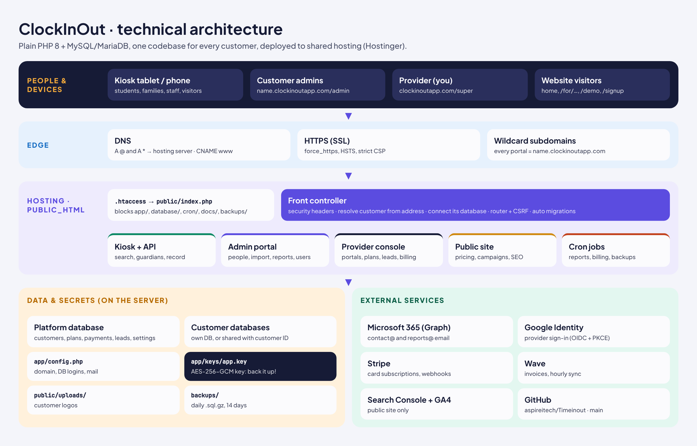
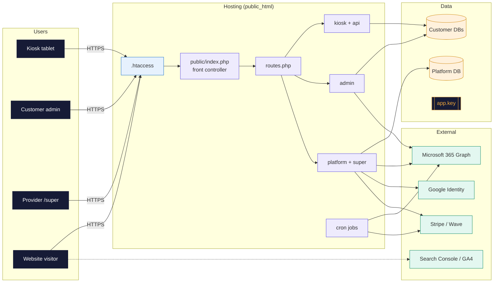
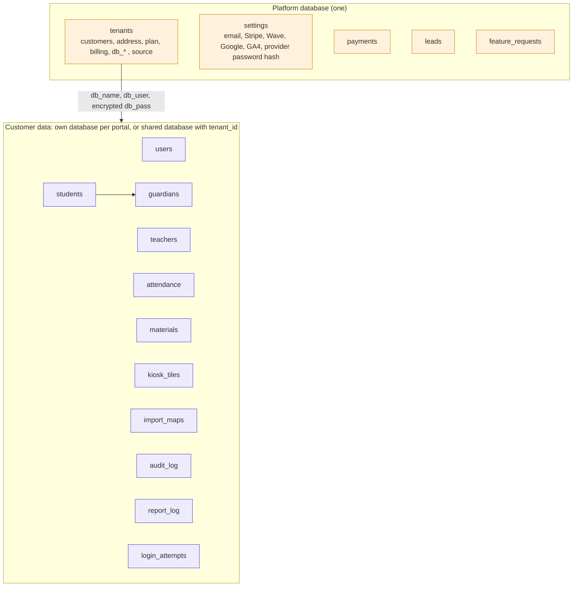
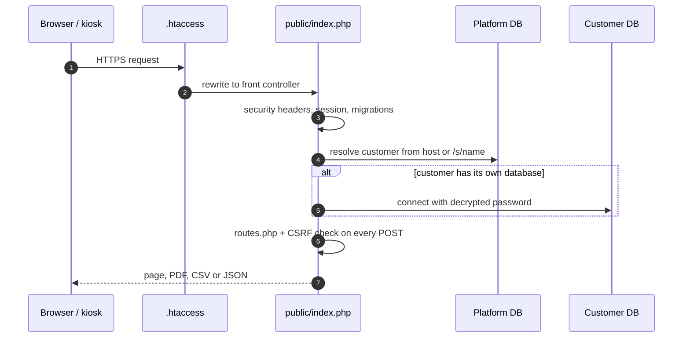
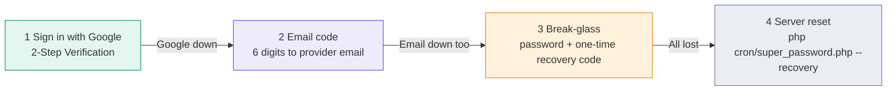
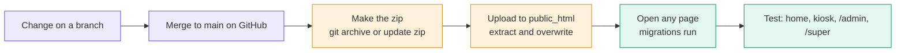
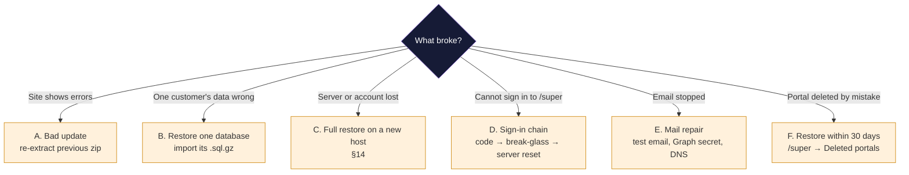

# ClockInOut — Master Guide

The single reference for ClockInOut: what it does, how it is built, how to configure, run, back up,
recover and move it. Hand this document to anyone who needs to take over the product.

| | |
|---|---|
| Product | ClockInOut, time & attendance for any front door — <https://clockinoutapp.com> |
| Code | GitHub **`aspireitech/Timeinout`** (public), branch **`main`** |
| Stack | PHP 8.1+ · MySQL 8 / MariaDB 10.4+ · Apache (`.htaccess`) · no framework, no build step |
| Hosting today | Hostinger shared hosting, code in `public_html` |
| Schema version | **15** (applied automatically on the first request after an update) |
| Last updated | 2026-11-12 — see [§18 Change log](#18-change-log) |

> **Never put real passwords, keys or customer data in this file or anywhere in the repository.**
> The repository is public. Secrets live only on the server (`app/config.php`, `app/keys/app.key`,
> the database) and in your password manager.

**Contents**
1. [Product overview](#1-product-overview) · 2. [Repository and branches](#2-repository-and-branches) ·
3. [Architecture](#3-architecture) · 4. [Data model and multi-tenancy](#4-data-model-and-multi-tenancy) ·
5. [Request flow](#5-request-flow) · 6. [Roles and sign-in](#6-roles-and-sign-in) ·
7. [Configuration reference](#7-configuration-reference) · 8. [Integrations](#8-integrations) ·
9. [Scheduled jobs](#9-scheduled-jobs-cron) · 10. [Security controls](#10-security-controls) ·
11. [Deploying and updating](#11-deploying-and-updating) · 12. [Backups](#12-backups) ·
13. [Disaster recovery](#13-disaster-recovery-runbooks) · 14. [Moving to another host](#14-moving-to-another-hosting-provider) ·
15. [Day-to-day operations](#15-day-to-day-operations) · 16. [Troubleshooting](#16-troubleshooting) ·
17. [Keeping this guide current](#17-keeping-this-guide-current) · 18. [Change log](#18-change-log)

---

## 1. Product overview

ClockInOut puts a tablet at the door. People sign in and out in a few taps; admins see live
attendance and get reports by email. Every customer (school, daycare, tutoring center, office,
clinic, gym…) gets its own portal at `name.clockinoutapp.com`.

| Area | What it does |
|---|---|
| **Kiosk** (`/` on a portal) | Tiles chosen per industry (students, staff, visitors, material pickup). Type a few letters → tap the name → choose who is with them (guardian on file, **Authorized relative** who types a name and picks a relationship, or **Self** for adults with no guardian) → Sign in / Sign out. One sign-in at a time; past days only as far back as the admin allows. |
| **Admin portal** (`/admin`) | Dashboard, today's attendance, activity log, reports (on screen, PDF, CSV, email), students & guardians, staff, pickup materials, import (Excel/CSV with column matching and undo), kiosk tiles, branding & settings, billing, users, audit log, Help & FAQ, What's new, feature requests. |
| **Provider console** (`/super`) | All portals (create, plan, status, delete/restore, owner password reset), leads, feature requests, payments, audit log, email/payment/Google settings, provider sign-in security. |
| **Public website** | Home, pricing (monthly/yearly), six campaign pages `/for/<industry>`, `/demo`, `/signup`, `/whats-new`, share links, SEO (sitemap, robots, structured data). |
| **Trial and billing** | Self sign-up → portal live at once, welcome email with the address and first steps. Bold trial banner (orange in the last 2 days). When the trial ends the admin portal opens only Billing (and Help) until a plan is chosen; the kiosk keeps working 7 more days, then pauses. Billing shows Yearly (2 months free) first with Business highlighted; without online payment set up, "Choose plan" emails you to send an invoice. |
| **Trial follow-up** | `app/lib/nurture.php`, run hourly. Emails the trial owner once per step, at most one a day, only 9:00–17:00 in the customer's time zone (portal setting, kiosk device, else their state): *import* (day 1+, no own people yet), *kiosk* (day 2+, no check-ins), *two-days* and *last-day* (with the optional promotion line). Alerts you (8:00–18:00 your time) when a trial has no check-ins after 2 days or ends tomorrow, with owner, people, check-ins and source. Every Monday from 8:00 in your time zone (`outreach_tz`) emails you a scorecard: new sign-ups, payments, paying customers, MRR, sign-ups and leads by source, open trials. Never emails paying customers or the demo. Sent emails are logged in `nurture_log`. On/off and promotion line in `/super → Settings`. |
| **Provider alerts** | To the contact mailbox, with a copy to `alert_emails` (`provider_alert()`, `alert_copies()` in `app/lib/mailer.php`): new sign-up, card subscription, payment received, payment failed (subject starts with ACTION), cancellation, demo request, invoice request, feature request, subdomain to-do, trial alerts, Monday scorecard, suspicious-activity report, recovery-code and break-glass sign-ins. |
| **Outreach to prospects** | `/super → Prospects` (`app/lib/prospects.php`, `app/controllers/prospects.php`). Prospects are pasted in, or posted by the daily Claude prospect finder to `POST /api/prospects` (header `X-Api-Key`; only its hash is stored; `GET` returns domains already known). Each gets email 1 written for its kind of business (`prospect_pitch()`: childcare/tutoring/schools, clinics and dental, offices, retail and restaurants, gyms, construction and field crews; matching banner and sign-up link with `industry=`), a follow-up after 4 days and a last note 5 days later, in the prospect's local time from their state (`STATE_TZ`, `prospect_send_window()`): Tue–Thu 9–12 and 13–15, Mon 10–12 and 13–15, Fri 9–12; at most `prospects_daily` (20) a day and `prospects_daily`/5 (4) per hourly run, sent from the contact mailbox. Stops when the address or its organization signs up or books a demo, is marked Replied/Bounced/Removed, or unsubscribes (`/unsubscribe?t=…`, button page). Skips k12/.gov addresses, no-reply style addresses, duplicates and a second address at the same organization (franchise mailbox domains such as mathnasium.com or ikumon.com count each address as its own center, `SHARED_DOMAINS`). Nothing is sent until sending is turned on and a name and postal address are saved. Weekly numbers appear in the Monday scorecard. |
| **Automation** | Scheduled reports at 7:00, Wave billing sync, purging of deleted portals after 30 days, subdomain re-check, daily backups. |

**Plans** (defined in `app/lib/billing.php` → `PLAN_CATALOG`; enforced in the app):

| | Starter | Business | Enterprise |
|---|---|---|---|
| Monthly / yearly | $39 / $390 | $79 / $790 | $149 / $1,490 |
| People (active students + staff) | 75 | 500 | unlimited |
| Staff logins | 3 | unlimited | unlimited |
| Report history | 90 days | 180 days | unlimited (12-month reports) |

Yearly = 10 months charged (`annual_months`). Trial = `trial_days` (7). Check-in itself is never limited.

---

## 2. Repository and branches

**GitHub:** <https://github.com/aspireitech/Timeinout>

| Branch | Purpose |
|---|---|
| `main` | Current production code. Deploy from here. |
| `claude/instance-provisioning-subscription-qpylpk` | Working branch for changes; merged into `main` after each change. PR #1 documents all work since the original version. |
| `claude/student-checkin-saas-app-r6ptl7` | The original first version (history only). |

**Get the code on a computer** (Git CMD on Windows):
```
cd /d D:\Project
git clone https://github.com/aspireitech/Timeinout.git
cd Timeinout
git checkout -b my-changes
```

**Folder map**

```
.htaccess              root rules: send requests to public/, block app/ database/ cron/ docs/ backups/
public/                the only folder browsers can reach
  index.php            front controller (every page goes through it)
  assets/              css/, js/, img/ (logo, icons, og/ share images)
  uploads/logos/       customer logos (not in git)
app/
  bootstrap.php        loads config and libraries
  routes.php           URL → function map (platform routes and portal routes)
  config.sample.php    template for app/config.php
  config.php           YOUR settings (not in git)
  keys/app.key         encryption key (not in git)  ← back it up
  sessions/            PHP sessions and temporary import files (not in git)
  controllers/         platform.php (website + /super), admin.php, kiosk.php, api.php
  lib/                 auth, billing, campaigns, crypto, csv_import, import_map, db, migrate,
                       mailer, pdf, reports, tenant, industries, whatsnew, audit, backup, demo, helpers
  views/               layouts/, partials/, platform/, admin/, kiosk/, auth/
cron/                  send_reports.php (hourly), backup.php (daily), super_password.php (emergency)
database/schema.sql    full schema for a fresh install
docs/                  this guide, GO_LIVE.md (click-by-click hosting setup), img/, older design notes
backups/               created by cron/backup.php (not in git)
```

Not in git (and must never be): `app/config.php`, `app/keys/`, `app/sessions/*`, `public/uploads/logos/*`, `backups/`.

---

## 3. Architecture





**Key design choices**
- **One codebase, many customers.** The web address decides which customer a request belongs to
  (`name.clockinoutapp.com`, or `clockinoutapp.com/s/name` in path mode).
- **No framework, no build.** Plain PHP files; deploying = copying files. Works on cheap shared hosting.
- **Server-rendered pages**; a little JavaScript for the kiosk, live checks and checklists.
- **Self-updating database.** `app/lib/migrate.php` upgrades the schema on the first request after a deploy.

---

## 4. Data model and multi-tenancy



- **Platform tables** (`PLATFORM_TABLES` in `app/lib/db.php`): `tenants`, `settings`, `payments`, `leads`, `feature_requests`. Always in the platform database.
- **Customer tables**: everything else. Every row carries `tenant_id`.
- **Dedicated database**: portals created in `/super → New portal` with "Own database" get a separate MySQL database. Its name, user and **encrypted** password are stored in `tenants`. The app switches to it for every request on that portal.
- **Shared database**: self sign-ups live in the platform database, separated by `tenant_id`.
- **Encrypted fields** (AES-256-GCM with `app/keys/app.key`): guardian and staff phone numbers and emails, extra imported info, customer database passwords, mailbox/Stripe/Wave/Google secrets.
- **Schema versions** (`SCHEMA_VERSION` in `app/lib/migrate.php`): 1–7 core and dedicated DBs · 8 feature requests · 9 lead source · 10 yearly billing (`billing_cycle`) · 11 Authorized relative switch · 12 sign-up source · 13 `subdomain_ok` · 14 `nurture_log` (trial follow-up emails already sent; platform table) · 15 `prospects` (outreach; platform table).
- **Portal addresses.** `name.clockinoutapp.com` needs the subdomain (and its SSL) set up on the host; Hostinger does not accept a `*` wildcard subdomain on the current plan. Every new portal is checked (`subdomain_live()` calls `https://name.clockinoutapp.com/__ping`); until it answers, `tenants.subdomain_ok = 0` and every link and email uses `clockinoutapp.com/s/name`, which always works. The hourly cron re-checks and switches links to the subdomain once it is live. `/super → Subscribers` shows "subdomain not live yet". The welcome email and page show the own address with **"will be live within 24 hours"** in red; you get a "To do: create subdomain …" email at sign-up, and the customer gets "Your address … is live" when the check succeeds.

---

## 5. Request flow



Special paths handled before routing: `/__ping` (answers `clockinout:<portal>`, used by the subdomain check), `/robots.txt` (portals: disallow all), share links `/linkedin /facebook /email /web /friend`, campaign pages `/for/<key>`, `/sitemap.xml`. Main-site routes `/unsubscribe` (outreach opt-out) and `/api/prospects` (prospect finder, key in `X-Api-Key`, no CSRF).

---

## 6. Roles and sign-in

| Role | Where | Sign-in | Can |
|---|---|---|---|
| Provider | `clockinoutapp.com/super` | Google → email code → break-glass | everything, all customers |
| Portal owner / admin | `name.clockinoutapp.com/admin` | email + password + emailed 6-digit code | manage their portal |
| Staff | portal kiosk | user ID (or email) + password | kiosk only |
| Families, members, visitors | kiosk | none | sign in/out on the kiosk |

**Provider sign-in chain**



- Set up in **`/super → Sign-in`**: Google Client ID/secret (stored encrypted), break-glass password (14+ characters, hashed), 10 recovery codes (shown once, each works once).
- Optional: `'super_google_code' => true` in `config.php` also asks for the email code after Google.
- Customer passwords: admins 10+ characters, staff 8+, with an uppercase letter, a lowercase letter and a number; a live checklist shows the rules while typing.
- Lockout: 5 failed attempts per email or 20 per IP in 15 minutes. Codes expire after 10 minutes (5 tries).
- Idle sign-out: admins and provider after 30 minutes; kiosk staff after 12 hours.

---

## 7. Configuration reference

### 7.1 `app/config.php` (on the server only; template: `app/config.sample.php`)

| Key | Meaning |
|---|---|
| `app_name` | Product name shown everywhere (ClockInOut). |
| `debug` | `false` on live. `true` shows PHP errors. |
| `db` | Platform database: `host`, `name`, `user`, `pass`, `port`. |
| `base_domain` | `clockinoutapp.com` (no www). Portals are `name.<base_domain>`. |
| `tenant_url_mode` | `subdomain` (live, needs wildcard DNS) or `path` (`/s/name`, dev). |
| `force_https` | `true` once SSL works. |
| `super_admin` | `email` = provider email (Google and email codes go here). `password` can be removed once the break-glass password is set in `/super → Sign-in`. |
| `super_otp` | Legacy switch for the emailed code; leave `true`. |
| `super_google_code` | Optional: `true` = Google sign-in also needs the email code. |
| `google_oauth` | Optional fallback for Google keys (`client_id`, `client_secret`, `allowed_emails`). Prefer `/super → Sign-in`. |
| `portal_db_prefix` | Start of suggested customer DB names (default: hosting prefix + `cio_`). |
| `lead_email` | Where `/demo` requests are emailed. |
| `app_key` | Leave empty: the key is generated at `app/keys/app.key`. **Back that file up.** |
| `trial_days` | Free trial length for self sign-ups (7). |
| `annual_months` | Months charged for a year (10 = two months free). |
| `plan_overrides` | Adjust a plan without code, e.g. `['starter' => ['amount' => 45]]`. |
| `mail` | `driver`: `graph` (Microsoft 365), `smtp` or `mail`; SMTP host/port/secure. |
| `graph` | Microsoft 365: `tenant_id`, `client_id`, `client_secret` (app registration with `Mail.Send`). |
| `mail_senders` | `contact` (codes, notices, leads) and `reports` (reports) mailboxes. |
| `contact_email` | Receives leads, suspicious-activity reports. |
| `report_bcc` | BCC copy of every emailed report (`false` to stop). |
| `cron_key` | Long random secret for the web cron URL `/cron?key=…`. |
| `backup_keep_days` | Days of backups kept by `cron/backup.php` (14). |

### 7.2 Settings stored in the database (`settings` table, edited in `/super`)

| Where | Settings |
|---|---|
| `/super → Settings` | Email delivery (driver, server, sender passwords, encrypted), admin sign-in codes on/off (`admin_otp`), Stripe secret key, webhook secret, **monthly and yearly price IDs per plan**, Wave token, business ID and product IDs, Google Search Console tag, GA4 measurement ID, Stripe Tax switch (`stripe_tax`), trial follow-up on/off (`nurture_on`, default on) and promotion line (`trial_promo`), extra alert recipients (`alert_emails`, up to 5: a copy of every provider alert). |
| `/super → Prospects` | Outreach on/off (`prospects_on`, default off), emails per day (`prospects_daily`), signature name and phone (`outreach_name`, `outreach_phone`), postal address (`outreach_address`), time zone (`outreach_tz`), prospect finder key (`prospect_api_key_hash`). |
| `/super → Sign-in` | Google Client ID and secret, break-glass password (hash), recovery codes (hashes). |

### 7.3 Settings per customer (`tenants` row, edited in the portal's **Branding & settings**)
Name, logo, colors, welcome text, time zone, kiosk without login, past-day entries (0–30 days),
**Always offer "Authorized relative"**, custom domain, report recipients/schedule/attachments, kiosk tiles.

### 7.4 Content in code
| File | Content |
|---|---|
| `app/lib/billing.php` | `PLAN_CATALOG` (prices, limits, features). |
| `app/lib/campaigns.php` | Campaign pages (`CAMPAIGNS`) and share links (`SHARE_LINKS`). |
| `app/lib/whatsnew.php` | Releases and roadmap shown on What's new. |
| `app/lib/industries.php` | Industries, their words and default kiosk tiles. |

---

## 8. Integrations

| Service | Used for | Set up |
|---|---|---|
| **Microsoft 365 (Graph)** | All email from contact@ and reports@ | Entra ID app registration → API permission **Mail.Send** (application) + admin consent → client secret → `graph` in `config.php`, `mail.driver = graph`. Restrict the app to the two mailboxes with an Exchange ApplicationAccessPolicy. DNS: SPF, DKIM, DMARC for the domain. Test in `/super → Settings → Send a test email`. |
| **Google Identity** | Provider sign-in | Google Cloud → Google Auth Platform: Branding (app name, domain), Audience **External / Testing** + your Gmail as test user, Client **Web application**, redirect URIs `https://clockinoutapp.com/super/google/callback` and `https://www.clockinoutapp.com/super/google/callback` → paste keys in `/super → Sign-in`. |
| **Stripe** | Card subscriptions | One product (tax code `txcd_10103001`, SaaS business use) with **6 prices**: monthly $39/$79/$149 and yearly $390/$790/$1,490 → paste each `price_…` ID (not the `prod_…` ID), the secret key and webhook secret in `/super → Settings`. Optional **Stripe Tax** switch there: checkout collects the billing address and adds sales tax (Utah taxes SaaS; register at tap.utah.gov). Webhook URL `https://clockinoutapp.com/webhooks/stripe` with events `checkout.session.completed`, `customer.subscription.updated`, `customer.subscription.deleted`, `invoice.paid`, `invoice.payment_failed`. Turn on the Customer Portal. |
| **Wave** | Invoices | Wave API token, business ID, one product ID per plan in `/super → Settings`. Yearly invoices use the same product at the yearly amount. Paid status synced hourly. |
| **Search Console** | Google search | Property `https://clockinoutapp.com/` → HTML tag → paste in `/super → Settings` → Verify → submit `sitemap.xml`. |
| **Google Analytics 4** | Visitor statistics | Web stream `https://clockinoutapp.com` → Measurement ID `G-…` in `/super → Settings`. Public site only. |
| **DNS (Namecheap or Cloudflare)** | Addresses | `A @` and `A *` → server IP, `CNAME www` → root. Wildcard is required for portal subdomains. |

---

## 9. Scheduled jobs (cron)

| Job | Schedule | Does |
|---|---|---|
| `php /home/USER/domains/clockinoutapp.com/public_html/cron/send_reports.php` | **every hour** | Sends due daily/weekly/monthly reports (at each portal's report hour, default 7:00 local), syncs Wave invoices, purges portals deleted more than 30 days ago, re-checks portals whose subdomain was not live yet, sends trial follow-up emails and alerts, outreach emails to prospects, and the Monday scorecard. `--force` sends reports now, `--scorecard` sends the scorecard now (testing). |
| `php /home/USER/domains/clockinoutapp.com/public_html/cron/backup.php` | **daily** (e.g. 02:00) | Dumps the platform database and every customer database to `backups/<date-time>/` as `.sql.gz` with `MANIFEST.txt`; keeps `backup_keep_days`. |
| `php cron/super_password.php [--recovery]` | by hand, emergencies | Sets a new provider break-glass password; `--recovery` prints new recovery codes. |

Adjust the path to where the code lives (Hostinger: hPanel → Advanced → Cron Jobs).
No cron on the host? Call `https://clockinoutapp.com/run-cron?key=CRON_KEY` hourly from an external pinger (same as `send_reports.php`). Use `/run-cron`, not `/cron`: when the whole project sits in `public_html`, `/cron` is the blocked `cron/` folder.

---

## 10. Security controls

| Layer | Control |
|---|---|
| Transport | HTTPS forced, HSTS, strict Content-Security-Policy, X-Frame-Options, nosniff, Referrer-Policy. GA4 domains are added to the policy only on the public site when an ID is set. |
| Files | Root `.htaccess` blocks `app/ database/ cron/ docs/ backups/ .git README.md`; `app/.htaccess`, `app/sessions/.htaccess`, `cron/.htaccess`, `database/.htaccess` contain `Require all denied`. |
| Sign-in | Emailed codes for admins, provider chain (Google → code → break-glass), lockout, idle sign-out, enforced password rules, must-change temporary passwords, "did not request this code? report it" link. |
| Requests | CSRF token on every POST, prepared SQL statements everywhere, output escaping (`e()`), kiosk JavaScript escapes every name. `X-Powered-By` removed. |
| Abuse limits | Sign-up: hidden bot field, at most 3 per network per hour, 10 per day, 2 per email per day (`signup_abuse()`). Demo form 5 per network per hour. Spreadsheet imports: 5 MB upload, parts over 40 MB unpacked refused (zip bombs), no external XML entities. CSV exports neutralise formulas (`= + - @`, tab, CR). |
| Data | Customers separated by database or `tenant_id`; AES-256-GCM for contacts and secrets; passwords hashed with `password_hash`. |
| Privacy | Portals send `noindex` and robots.txt disallows them; no analytics in portals or `/super`. |
| Audit | Every sign-in, change, import, export and payment event in `audit_log` (portal) and the provider audit log. |
| Resilience | Daily backups (14 days), deleted portals kept 30 days (Restore in `/super`), dedicated DB saved to `backups/deleted/` before removal. |

The separate private **security tracker** (Excel, not in the repo) lists open action items.

---

## 11. Deploying and updating



**Full package from GitHub** (on your computer):
```
cd /d D:\Project\Timeinout
git checkout main
git pull
git archive --format=zip -o ClockInOut.zip HEAD
```
The zip never contains `config.php`, `app.key`, uploads or backups, so extracting it over the live site keeps them.

**Upload on Hostinger:** File Manager → `public_html` → Upload the zip → Extract here → overwrite.
Never extract inside `app/` (that would overwrite `app/.htaccess`). After extracting, open any
page once; the database upgrades itself.

**First install on a new server:** see [§14](#14-moving-to-another-hosting-provider) steps 2–8,
and `docs/GO_LIVE.md` for click-by-click hosting screens.

**Rollback:** keep the previous zip; extract it over the site. Schema changes are additive
(new columns/tables), so older code keeps working on a newer database.

---

## 12. Backups

| What | Why it matters | How it is protected | You must also |
|---|---|---|---|
| Platform database | Customers, which DB each uses, settings, payments, leads | `cron/backup.php` daily | copy `backups/` off the server weekly |
| Customer databases | All people, guardians, attendance, logins, audit | `cron/backup.php` daily | same |
| **`app/keys/app.key`** | Decrypts contacts, customer DB passwords, all secrets | not backed up automatically | **store in password manager now** |
| `app/config.php` | Domain, DB logins, mail settings | not backed up automatically | copy its contents to the password manager |
| `public/uploads/logos/` | Customer logos | — | download occasionally |
| Code | Same for every customer | GitHub `main` | — |
| Hostinger backups | Whole account snapshots | Hostinger plan feature | check retention in hPanel |

**Off-site copy routine (weekly):** hPanel → File Manager → `backups/` → download the newest folder → store in cloud storage (OneDrive/Google Drive), keep 4–8 weeks.

**Test a restore every quarter** on a dev copy (see §13 scenario C).

**Recovery objectives:** data loss at most 1 day (daily backups; less with Hostinger snapshots); restore time 1–3 hours for a full move.

---

## 13. Disaster recovery runbooks



**A. A release broke the site**
1. Extract the previous zip over `public_html`.
2. Open the home page and a portal. If an error persists, set `'debug' => true` briefly in `config.php`, read the message, set it back.

**B. One customer's data is wrong or lost**
1. Find the newest good backup: `backups/<date>/<portal>_<database>.sql.gz` (see `MANIFEST.txt`).
2. hPanel → Databases → phpMyAdmin → select that customer's database → Import → choose the `.sql.gz`.
3. Shared-database customers: restore into a scratch database and copy that customer's rows (by `tenant_id`) back.

**C. Server or hosting account lost**
Follow §14 using your off-site backups, `config.php` contents and `app.key` from the password manager.

**D. Locked out of `/super`**
Google → email code → break-glass (password + recovery code) → server: `php cron/super_password.php --recovery` over SSH. Then create new recovery codes.

**E. Email stopped**
`/super → Settings → Send a test email`. Common causes: expired Graph client secret (renew in Entra ID, update `config.php`), changed mailbox, DNS (SPF/DKIM). While email is down, provider uses break-glass; customer admin codes cannot arrive, so you can temporarily turn off admin sign-in codes in `/super → Settings` and turn them back on after.

**F. Portal deleted by mistake**
Within 30 days: `/super → Subscribers → Deleted → Restore`. After that: restore from `backups/deleted/` or the daily backup (scenario B), then re-create the `tenants` row from the platform backup.

**G. `app.key` lost**
Encrypted fields (contacts, customer DB passwords, secrets) cannot be decrypted. Recovery: restore `app.key` from the password manager. There is no other way — keep two copies.

---

## 14. Moving to another hosting provider

Requirements: PHP 8.1+ with `pdo_mysql`, `openssl`, `mbstring`, `zip`, `zlib`, `curl`; MySQL 8 / MariaDB 10.4+; Apache with `mod_rewrite` (or Nginx with the equivalent rules); wildcard subdomain support; cron jobs; SSL including the wildcard.

1. **Prepare (old host):** run `cron/backup.php` once, download the newest `backups/<date>/`, `app/config.php`, `app/keys/app.key`, `public/uploads/`.
2. **Code:** make the zip from GitHub `main` (§11) and extract it in the new web root.
3. **Secrets:** upload `app/config.php` and `app/keys/app.key` to the same paths. `chmod 600` both.
4. **Databases:** create the platform database and each dedicated customer database. Use the **same names, users and passwords** where possible; import each `.sql.gz` (phpMyAdmin accepts `.gz`, or `gunzip -c file.sql.gz | mysql -u USER -p DBNAME`).
   - If names must change (new hosting prefix): update `db` in `config.php` for the platform database. For each customer database, run this once from the code folder over SSH (replace the values; the password is encrypted with `app.key` automatically):
     ```
     php -r 'require "app/bootstrap.php"; update("tenants", ["db_name" => "NEW_DB", "db_user" => "NEW_USER", "db_pass" => encrypt_pii("NEW_PASS")], "slug = ?", ["portalname"]);'
     ```
     No SSH? Keep the same database passwords on the new host and only change names in phpMyAdmin (`tenants` table, `db_name` / `db_user`).
5. **Uploads:** copy `public/uploads/logos/`.
6. **Subdomains:** add wildcard `*.clockinoutapp.com` pointing to the same web root (Hostinger: Subdomains → custom folder `public_html`).
7. **Cron:** add the hourly `send_reports.php` and daily `backup.php` jobs with the new paths (§9).
8. **Test before switching DNS:** use a hosts-file entry or the host's temporary URL: home page, `/super` sign-in, one portal kiosk, one report, `/super → Settings → Send a test email`.
9. **Switch DNS:** change `A @` and `A *` to the new server IP (lower TTL a day earlier). Wait for SSL to issue for the root and wildcard.
10. **After:** update the Google sign-in redirect URIs if the domain changed, Stripe webhook URL, Search Console; keep the old host read-only for a week, then cancel.

---

## 15. Day-to-day operations

| Task | Where |
|---|---|
| Create a customer portal with its own database | `/super → New portal` (create the database in hPanel first; the form suggests names) |
| Give a portal its `name.clockinoutapp.com` address | hPanel → Domains → Subdomains → create `name`, Custom folder → `public_html`, then install its SSL; links switch automatically within an hour |
| Customer chose a plan without online payment | You get "… chose the X plan" email → send the invoice → `/super → Subscribers` → status **active** |
| Change a customer's plan or status | `/super → Subscribers` |
| Reset a portal owner's password | `/super → Subscribers → Reset owner password` |
| See where sign-ups came from | `/super → Subscribers` ("via …" badge) and `/super → Leads` |
| Share links | `clockinoutapp.com/linkedin`, `/facebook`, `/email`, `/web`, `/friend`; campaign pages `/for/schools`, `/tutoring`, `/offices`, `/healthcare`, `/gyms`, `/construction` (add `?src=channel`) |
| Answer feature requests | `/super → Requests` |
| Payments overview, MRR | `/super → Payments` |
| Publish news or roadmap | edit `app/lib/whatsnew.php`, deploy |
| Change prices or limits | edit `PLAN_CATALOG` in `app/lib/billing.php`, deploy; create matching Stripe prices |
| Customer imports staff/students | portal → Teachers & staff / Students → **Import** (opens that list only); undo available for a day |
| Rebuild the demo portal | `/super → Rebuild demo` |

---

## 16. Troubleshooting

| Symptom | Likely cause → fix |
|---|---|
| "Cannot connect to the database" | Wrong `db` in `config.php`, or database server down. |
| A portal shows "There is no portal at this address" | Typo in the address, or wildcard DNS/subdomain missing. |
| `name.clockinoutapp.com` shows "can't provide a secure connection" | Subdomain not set up in hPanel (no SSL for it). Use `clockinoutapp.com/s/name`, or add the subdomain (§15). |
| Portal opens but errors on its data | Its dedicated database login changed → update `tenants.db_*` with the command in §14 step 4. |
| Sign-in codes not arriving | §13 E. |
| Google sign-in "redirect_uri_mismatch" | Add both redirect URIs exactly (§8). |
| Google "not allowed to open the provider console" | Signed in with a Gmail other than `super_admin.email`. |
| Link previews show no picture | Update not uploaded (`/assets/img/og/og-default.jpg` 404) or the app cached the old preview; share `?v=2`. |
| Import went into the wrong list | Undo on the Students/Staff page (24 h), then use that list's own Import button. |
| Pricing shows wrong amounts | `plan_overrides` in `config.php` or an old deployment. |
| Analytics shows nothing | GA4 ID not saved, or ad blocker; check Realtime with a phone on mobile data. |

---

## 17. Keeping this guide current

Every change that adds or alters a feature, setting, integration, cron job, table or deployment
step must update this guide **in the same commit**:

1. Update the relevant section (features §1, config §7, integrations §8, cron §9, data §4 …).
2. Bump **Schema version** in the header table when `SCHEMA_VERSION` changes, and list it in §4.
3. Add a line to the change log (§18) with the date and a one-line summary.
4. If architecture changes, update the Mermaid diagrams and re-render `docs/img/architecture.png`.
5. Refresh the Confluence space **CIO** ("ClockInOut Technical Documentation" on aspireitech.atlassian.net): edit the matching page source in `docs/confluence/` (map in `pages.json`), republish the changed pages, and rebuild the offline copy with `python3 docs/confluence/build_offline.py ClockInOut-Docs-Offline.zip` (attach it to the space home page). Screenshots live in `docs/img/screens/`.

`CLAUDE.md` in the repository root asks Claude to follow these rules automatically.

---

## 18. Change log

| Date | Change |
|---|---|
| 2026-10 | Go-live: per-customer databases, provider console, import with column matching, reports, Microsoft Graph email, campaign pages, lead sources, link previews, logo kit. |
| 2026-10-29 | Plans with limits and yearly billing (schema 10). |
| 2026-10-30 | New prices $39/$79/$149, report history limits, Authorized relative (schema 11), material pickups card, users page layout. |
| 2026-10-31 | Import into the right list + undo, relationship buttons, custom portal address at sign-up, live password checklist, sign-up source tracking (schema 12), share links, SEO (sitemap, robots, structured data, Search Console, GA4). |
| 2026-11-01 | Provider sign-in: Google → email code → break-glass; Google keys saved in `/super → Sign-in`. |
| 2026-11-03 | This master guide. |
| 2026-11-06 | Stripe Tax switch in /super → Settings (automatic tax and billing address at checkout). |
| 2026-11-06 | 24-hour address promise: red note in welcome email/page, provider to-do email, "address is live" email. |
| 2026-11-06 | Trial sign-up: welcome email, `/s/name` links until the subdomain is live (schema 13, hourly re-check, `/__ping`); bold trial and red ended banners; admin locked to Billing when the trial ends; Billing defaults to Yearly with Business highlighted and every plan selectable ("Choose plan" request when online payment is not set up). |
| 2026-11-06 | Trial follow-up emails, provider alerts and Monday growth scorecard (schema 14, `nurture_log`); on/off and promotion line in /super → Settings. |
| 2026-11-06 | `docs/SAAS_BLUEPRINT.md`: reusable multi-tenant SaaS design (demo, trial, lock, billing, shared or own database) for other projects. |
| 2026-11-09 | Outreach to prospects: `/super → Prospects`, 3-email sequence with automatic stop, unsubscribe page, prospect finder API (schema 15). |
| 2026-11-09 | Prospects: franchise mailbox domains (Kumon, Mathnasium, Sylvan, …) are treated per center, not per domain. |
| 2026-11-09 | Prospects: all small-business types (clinic, dental, office, gym, construction, retail, restaurant…) with an email written for each. |
| 2026-11-09 | Provider alerts: copy to extra addresses (/super → Settings), new alerts for sign-ups, card subscriptions, payments and cancellations. |
| 2026-11-09 | Local-time sending: outreach in each prospect's business hours (by state), trial emails 9–17 customer time, alerts 8–18 and Monday scorecard 8:00 provider time. |
| 2026-11-10 | Security review: sign-up abuse limits and bot field, zip-bomb guard on .xlsx import, CSV formula guard for tab/CR, `X-Powered-By` hidden, `/run-cron` web cron address. |
| 2026-11-12 | Confluence space CIO with step-by-step pages and screenshots (`docs/confluence/`), private credentials register, offline documentation copy. |
