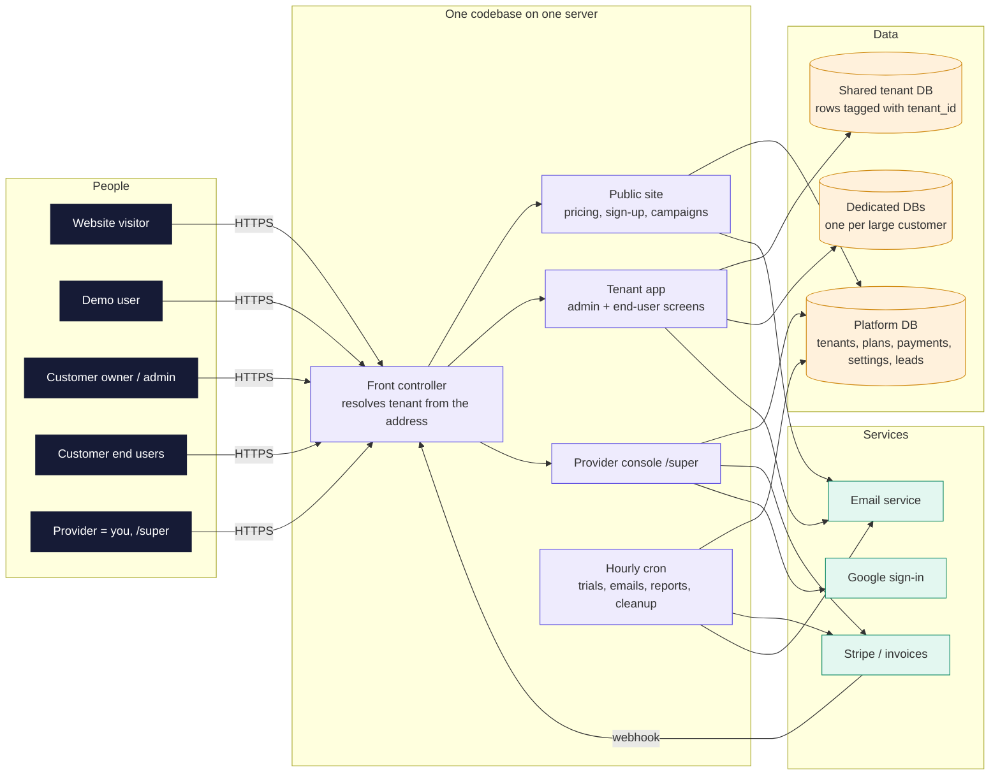
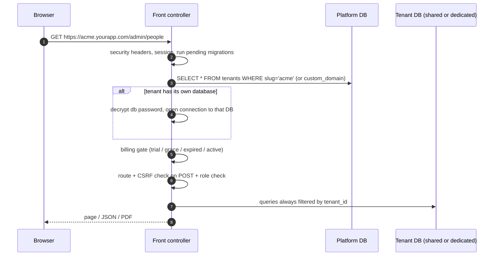
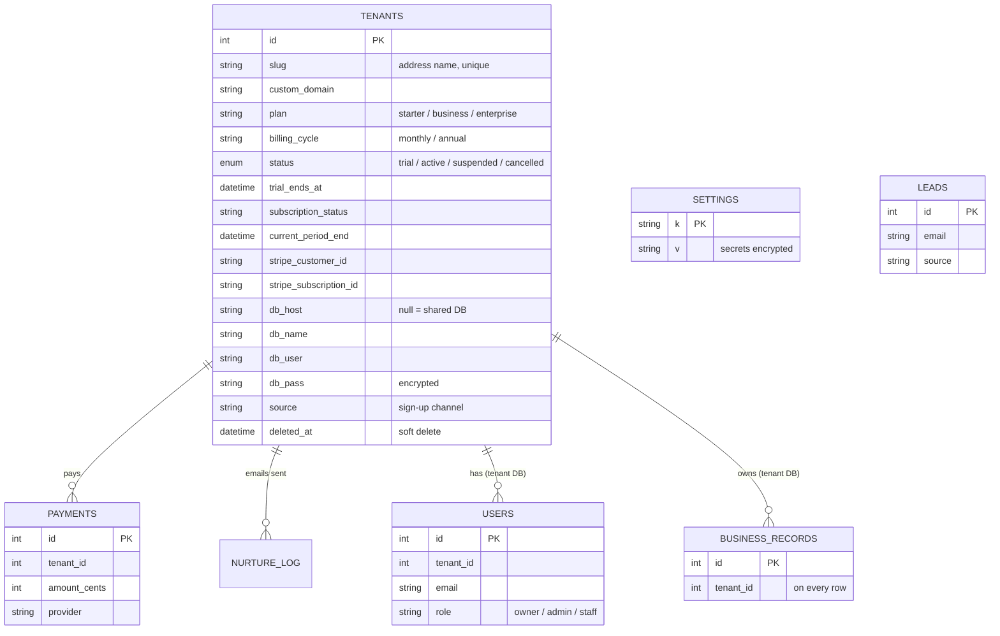
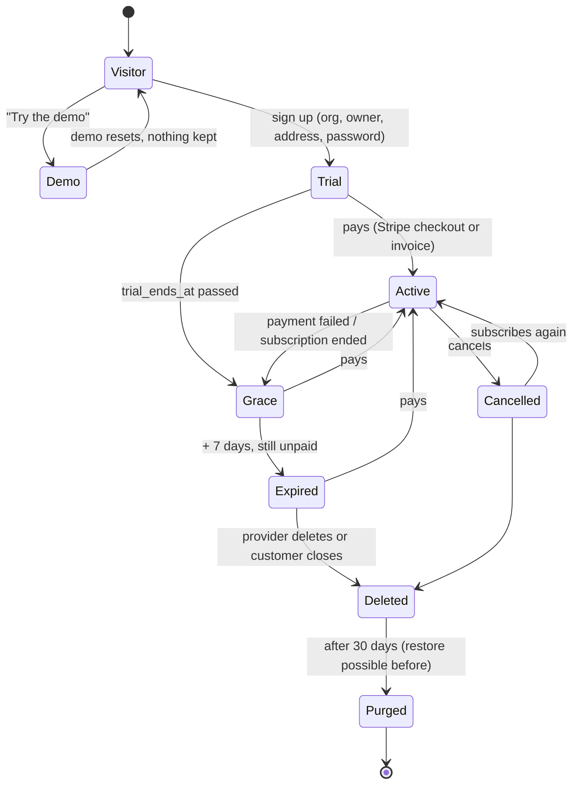

# Multi-tenant SaaS Blueprint

A reusable design for selling one web app to many customers: a public demo, self sign-up, a free trial,
automatic lock when the trial ends, online subscriptions, and customer data kept apart (shared database
or one database per customer).

It is written so another project (or another Claude session) can read it on its own and decide whether
the pattern fits. **Reference implementation:** ClockInOut (this repository), plain PHP 8 + MySQL on
shared hosting. File and function names in `code` point to that implementation; the design itself does
not depend on PHP.

---

## 1. Is it a fit? (quick checklist)

Good fit when most answers are **yes**:

| Question | Why it matters |
|---|---|
| Each customer is an organization with its own users and its own data? | The whole design is built around a "tenant" = one customer organization. |
| Customers never need to see each other's data? | Data is separated by tenant; cross-tenant features need extra design. |
| You want people to try it without talking to you (demo + free trial)? | Sign-up, trial, lock and checkout are fully automatic. |
| Price is a monthly / yearly subscription per organization? | Plans, limits and billing states assume this. |
| Some customers (schools, clinics, enterprises) may ask for their data in a separate database? | Supported per tenant, no code change. |
| You want cheap hosting and simple deploys (copy files, no build)? | One codebase serves every customer; the schema upgrades itself. |

Probably **not** a fit, or needs changes, when:
- Customers are individuals, not organizations (a simpler user-account model is enough).
- You need per-customer code customization (this is one codebase for all).
- You need usage-based / metered billing (add Stripe metered prices and usage reporting).
- Very high traffic per tenant or real-time collaboration (move to a bigger stack: queues, websockets, managed DB).
- Strict data-residency per country (dedicated databases help, but hosting location must also be chosen per tenant).

---

## 2. The big picture



**Core ideas**
1. **One codebase, many tenants.** The web address decides which customer a request belongs to.
2. **Two kinds of data.** *Platform data* (who the customers are, their plan and billing) lives in one
   platform database. *Tenant data* (the customer's own records) lives either in a shared database,
   tagged with `tenant_id`, or in the customer's own database.
3. **The lifecycle is a state machine** (visitor → trial → paid → cancelled → deleted) computed from a
   few columns on the tenant row, and one "gate" function decides what each state may open.
4. **Everything automatic runs from one hourly cron**: trial emails, lock, payment sync, cleanup.

---

## 3. Front end and back end in the same environment

The same server and codebase serve:

| Part | Address | Who |
|---|---|---|
| Public site (marketing, pricing, sign-up, campaign pages) | `yourapp.com`, `yourapp.com/for/<campaign>` | visitors |
| Tenant app | `name.yourapp.com` or `yourapp.com/s/name` | each customer |
| Provider console | `yourapp.com/super` | you |
| API / webhooks / cron URL | `yourapp.com/webhooks/stripe`, `yourapp.com/cron?key=…` | Stripe, pingers |

Pages are rendered on the server, with small JavaScript where needed. That keeps one deploy and one
session/CSRF model. A separate SPA front end (React, etc.) also works with this design: keep the tenant
resolution and the gate on the API side and send the tenant in the host name or path.

### How a request finds its tenant



Tenant resolution order (`resolve_tenant()` in `app/lib/tenant.php`):
1. Path form `yourapp.com/s/<slug>/…`. Always works, no DNS or SSL setup per customer.
2. Subdomain `<slug>.yourapp.com`. Needs wildcard DNS plus wildcard SSL, or one subdomain created per customer.
3. Custom domain `checkin.customer.com`, looked up in `tenants.custom_domain`.
4. Otherwise it is the public site.

Tip from production: when the host cannot do wildcard subdomains, give every new tenant the `/s/<slug>`
address first, check the subdomain hourly (`/__ping` answers `app:<slug>`) and switch links to the
subdomain once it answers (`tenants.subdomain_ok`).

---

## 4. Data design



Rules:
- **Platform tables** (`tenants`, `settings`, `payments`, `leads`, `nurture_log`, …) live only in the platform DB.
- **Tenant tables** (users and all business data) carry `tenant_id` on every row and every query filters by it,
  even inside a dedicated database. The same SQL then works in both modes, and a tenant can be moved
  between shared and dedicated storage by copying rows.
- **Query routing.** One function picks the connection: if the SQL names a platform table it goes to the
  platform DB, otherwise to the current tenant's DB (`conn_for()`, `with_tenant_db()` in `app/lib/db.php`).
  Feature code never has to think about which database it is using.
- **Dedicated database per tenant** (optional, per customer): create an empty DB, store host/name/user
  and the **encrypted** password on the tenant row; the app installs the schema into it
  (`tenant_db_install()`) and keeps it migrated (`tenant_db_migrate()`).
- **Self-upgrading schema.** `SCHEMA_VERSION` plus `migration_N()` functions, only additive changes, run
  on the first request after a deploy under a DB lock. Dedicated DBs are migrated the same way.
- **Encryption at rest** for personal data and secrets (AES-256-GCM with a key file outside the web root).

### Shared vs dedicated database

| | Shared DB (default for self sign-up) | Dedicated DB (per customer) |
|---|---|---|
| Setup | automatic at sign-up | provider creates an empty DB, enters it in `/super` |
| Isolation | by `tenant_id` in every query | separate database and DB user |
| Backup / restore / export one customer | filter by `tenant_id` | dump one database |
| Good for | small customers, trials | schools, enterprise, contracts that require it |
| Cost | none | one DB each (hosting limits apply) |

---

## 5. Customer lifecycle (the complete flow)



What each state allows (`billing_state()` and `billing_gate()` in `app/lib/billing.php`):

| State | How it is computed | Admin screens | End-user screens | Banner |
|---|---|---|---|---|
| trial | status = trial, now ≤ trial_ends_at | all | all | "N days left" (orange in the last 2 days) |
| grace | trial ended ≤ 7 days ago, or payment failed | **only Billing, password, help, sign out** | still work | red "trial ended, choose a plan" |
| expired | grace over, or status = cancelled | only Billing | **paused** (HTTP 402 page) | red |
| active | status = active (set by payment webhook) | all, limited by plan | all | none |
| suspended | provider suspended it | only Billing | paused | red |

The gate is **one function called on every request**, so new features are protected automatically.
Only an allow-list of paths stays open when locked (`BILLING_OPEN_PATHS`).

### 5.1 Demo ("play with real-looking data")

Two kinds, both in the reference app:

1. **Public demo tenant**: one tenant with slug `demo`, loaded with realistic sample data (people,
   relations, about 6 weeks of activity), fixed demo logins shown on screen, never billed and never
   emailed. The provider can reset it with one click in `/super` (`seed_demo_tenant()` deletes it and
   rebuilds it from a fixed random seed, so it always looks the same). Visitors can change anything;
   a reset brings it back.
2. **Sample data in a new trial**: a checkbox at sign-up adds a few sample records to the customer's
   own new tenant (`seed_demo_people()`), so the first screen is never empty. Real activity is told
   apart from sample data by creation time, which the trial emails use.

### 5.2 Sign-up and provisioning

```mermaid
sequenceDiagram
  autonumber
  actor U as Visitor
  participant S as Sign-up page
  participant A as App
  participant P as Platform DB
  participant T as Tenant DB
  participant M as Email
  U->>S: org name, owner name, email, password, address name, (sample data?)
  S->>A: POST (CSRF, rate limit, password rules, address free?)
  A->>P: INSERT tenants (status=trial, trial_ends_at=now+7d, plan, source)
  A->>T: install schema if dedicated, then owner user, defaults, optional sample data
  Note over A,T: one transaction; on any error the tenant row is removed
  A->>M: welcome email (address, sign-in link, first steps)
  A->>P: audit log "New sign-up" (with source), shown in /super
  A->>M: provider to-do email (create the subdomain) when needed
  A-->>U: welcome page, signed in, trial banner
```

`provision_tenant()` in `app/lib/tenant.php` is the single function used by both self sign-up and
"New portal" in the provider console.

### 5.3 Trial follow-up (automatic, hourly)

| When | To | Email |
|---|---|---|
| Day 1+, no own records yet | owner | "Add your data (we can do it for you)" |
| Day 2+, product not used yet | owner | "3 steps to start" |
| 2 days left | owner | plans, recommended plan, optional promo code |
| Last day | owner | "Trial ends tomorrow, choose a plan; your data is safe" |
| Day 2+ unused, or ends tomorrow | provider | alert with owner, usage, source: call them |
| Monday 7:00 | provider | scorecard: sign-ups, payments, paying customers, MRR, sources, open trials |

Each email is sent once per tenant (`nurture_log`), at most one per day, never to paying customers or
the demo (`app/lib/nurture.php`).

### 5.4 Subscription and payment

```mermaid
sequenceDiagram
  autonumber
  actor O as Owner
  participant A as App (Billing page)
  participant S as Stripe
  participant W as Webhook /webhooks/stripe
  participant P as Platform DB
  O->>A: choose plan + monthly / yearly
  A->>S: create Checkout Session (price id, tenant id in metadata, tax optional)
  S-->>O: Stripe checkout page (card)
  O->>S: pays
  S->>W: checkout.session.completed (signed)
  W->>W: verify signature, find tenant by metadata / customer id
  W->>P: status=active, plan, cycle, subscription id, period end; record payment
  Note over S,W: later: invoice.paid (renewal), invoice.payment_failed,<br/>customer.subscription.updated / deleted keep the row in sync
  O->>A: "Manage billing" opens the Stripe customer portal (card, cancel, invoices)
```

- Plans live in one catalog (`PLAN_CATALOG`): price, limits (records, logins, history days), features.
  Yearly = 10 × monthly ("2 months free").
- Limits are enforced in the app (`people_room()`, `login_room()`, `report_earliest()`), not only on the
  pricing page.
- Stripe renews automatically. The webhook is the **only** place that marks a tenant as paid.
- Alternative for customers who pay by invoice: the owner presses "Request invoice", the provider gets
  an email, and the invoice tool (Wave in the reference app) is synced hourly.

### 5.5 Cancel, delete, purge

Cancel → `status = cancelled` (from webhook) → expired gate. Delete → `deleted_at` set (soft delete),
restorable for 30 days → hourly cron purges the rows (or drops the dedicated DB contents) after that.

---

## 6. Roles and sign-in

| Role | Where | Sign-in |
|---|---|---|
| Provider (you) | `/super` on the main domain | Google sign-in → email code → break-glass password + one-time recovery code |
| Owner / admin | tenant `/admin` | email + password + emailed 6-digit code (optional) |
| Staff | tenant | user ID + password |
| End users | tenant public screens | none, or what the product needs |

Protections: CSRF token on every POST, lockout (5 tries per account, 20 per IP / 15 min), idle sign-out,
password rules with live checklist, audit log of admin actions, security headers and CSP.

---

## 7. Scheduled jobs (one hourly cron)

| Job | Does |
|---|---|
| reports | sends each tenant's scheduled reports at its local hour |
| payment sync | invoice status from the invoice provider |
| trial follow-up | emails and provider alerts (section 5.3), Monday scorecard |
| address check | switches `/s/name` links to the subdomain when it answers |
| purge | removes tenants deleted more than 30 days ago |
| backup (daily) | dumps platform DB + every dedicated DB, keeps N days |

No cron on the host? An external pinger calls `https://yourapp.com/cron?key=SECRET` hourly.

---

## 8. Provider console (`/super`)

Subscribers list (plan, state, source, "address not live yet"), new tenant (shared or dedicated DB),
suspend / restore / delete, reset demo, leads, payments, settings (email, Stripe keys and price IDs,
tax switch, invoice tool, analytics, trial emails on/off and promo line), sign-in setup (Google keys,
break-glass, recovery codes).

---

## 9. How to apply it to another project

1. **Name your tenant.** What is one customer: a school, a clinic, a store? That row is `tenants`.
2. **Split your tables.** Platform tables (customers, billing, settings, leads) vs tenant tables. Add
   `tenant_id` to every tenant table and to every query (or a repository/ORM scope that adds it).
3. **Front controller.** One entry point: resolve tenant (path → subdomain → custom domain), open the
   tenant's DB connection if dedicated, run the billing gate, route, check CSRF and role.
4. **Connection routing.** One function decides platform DB vs tenant DB, so feature code stays simple.
5. **Lifecycle columns.** `status`, `trial_ends_at`, `plan`, `billing_cycle`, `subscription_status`,
   `current_period_end`, payment-provider IDs, `deleted_at`. Write `billing_state()` and `billing_gate()`.
6. **Provisioning.** One `provision_tenant()` used by sign-up and the console; transactional; optional
   sample data.
7. **Demo tenant** with a reset function and fixed demo logins.
8. **Payments.** Stripe Checkout (subscription mode, one price per plan × cycle), customer portal, and a
   signed webhook that is the only thing that activates a tenant.
9. **Plans and limits** in one catalog, enforced in the app.
10. **Cron** for trial emails, lock (computed, so no job needed), cleanup, backups.
11. **Migrations** that run automatically and are additive, applied to every dedicated DB too.
12. **Provider console** and **audit log**.

Stack mapping (if the other project is not plain PHP):

| Piece | Laravel | Node (Express / Nest) | Django | Next.js + Supabase |
|---|---|---|---|---|
| Tenant resolution | middleware | middleware | middleware | middleware + RLS |
| `tenant_id` filter | global scope | query helper / Prisma extension | model manager | Postgres row-level security |
| Dedicated DB | dynamic DB connection | connection per tenant | DB router | separate project / schema |
| Billing gate | middleware | middleware | middleware | middleware |
| Cron | scheduler | node-cron / platform cron | celery beat | Vercel cron / edge functions |
| Migrations | migrations | Prisma / TypeORM | migrations | SQL migrations |

---

## 10. Risks and answers

| Risk | Answer in this design |
|---|---|
| One customer sees another's data | tenant resolved once per request; `tenant_id` on every row and query; dedicated DB option; tests that try cross-tenant IDs |
| Trial users keep using it for free | computed state + one gate on every request; only Billing open |
| End users blocked the moment a trial ends | 7-day grace: end-user screens keep working, only admin is locked |
| Payment marked by mistake | only the signed Stripe webhook activates a tenant |
| Deploy breaks schema | additive migrations under a lock, versioned, applied automatically |
| Wildcard subdomains unavailable | `/s/<slug>` addresses work from minute one |
| Losing the provider login | three sign-in methods plus a server-side reset script |
| Secrets in a public repo | config and key files never committed; secrets stored encrypted in the DB |

---

## 11. Evaluation questions for the other project

Answer these to confirm fit and size the work:
1. What is one tenant, and roughly how many tenants and users per tenant in year one?
2. Which tables are tenant data, and which are shared reference data?
3. Does any customer need its own database or data location?
4. What should a trial user see on day one (sample data)? What does the public demo show?
5. What is locked when the trial ends, and what must keep working for end users?
6. Plans: what differs between them (limits, features, support)? Monthly and yearly?
7. Payment: card (Stripe), invoice, or both? Sales tax needed?
8. Which emails should be automatic (welcome, trial steps, receipts, alerts)?
9. Current stack and hosting? (See the mapping table in section 9.)
